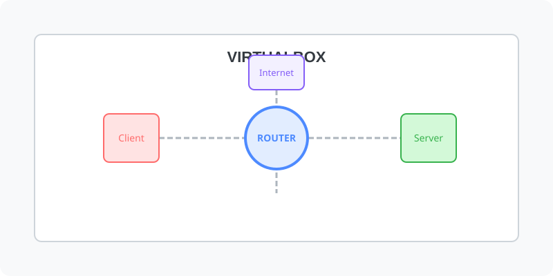

[⬅️ 이전: NAT (Network Address Translation)](../) &nbsp;|&nbsp; [🏠 분류 목차](../../../../) &nbsp;|&nbsp; [다음: Vmware ➡️](../vmware/)

---
layout: home
---

---

[⬅️ 이전: NAT (Network Address Translation)](../) &nbsp;|&nbsp; [🏠 분류 목차](../../../../) &nbsp;|&nbsp; [다음: Vmware ➡️](../vmware/)
