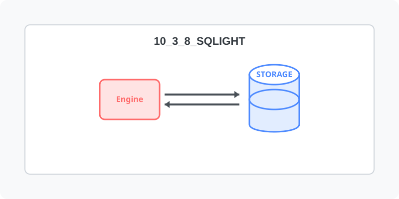

[⬅️ 이전: 리눅스에 Redis 설치하기](../10_3_7_redis/) &nbsp;|&nbsp; [🏠 분류 목차](../../../) &nbsp;|&nbsp; [다음: 11장. 리눅스 개발 환경 (Dev) ➡️](../../../12_dev/)

# SQLight 설치하기

---

[⬅️ 이전: 리눅스에 Redis 설치하기](../10_3_7_redis/) &nbsp;|&nbsp; [🏠 분류 목차](../../../) &nbsp;|&nbsp; [다음: 11장. 리눅스 개발 환경 (Dev) ➡️](../../../12_dev/)
