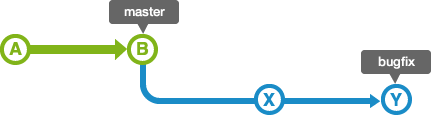
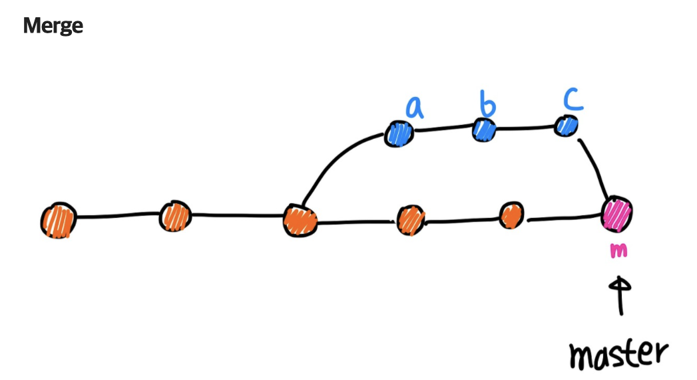
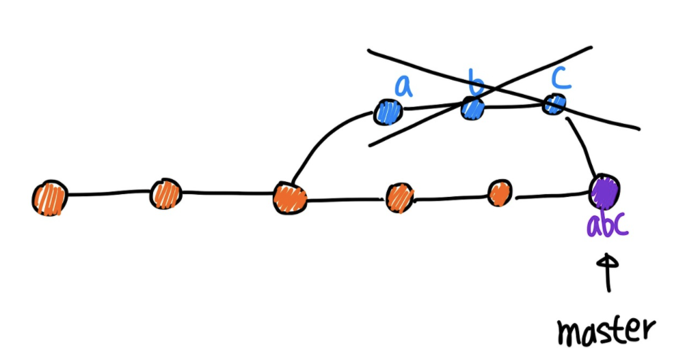
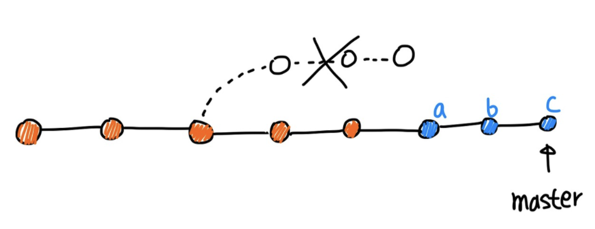

# Git 브랜치 병합(Merge)의 4가지 주요 전략

소프트웨어 개발 시, 여러 작업자가 하나의 코드 기반(Branch)에서 파생되어 각자의 코드를 추가한 다음, 이를 합치는 병합 과정(`git merge`)은 필수적입니다. 이 과정에서 대표적으로 사용되는 4가지 철학과 방식을 이해하면 충돌 없는 깔끔한 깃 히스토리를 만들 수 있습니다.

## 1. Fast-forward Merge (빨리감기 병합)
가장 평화롭고 이상적인 병합 상태입니다.

1. `master` 줄기에서 `bugfix`라는 가지를 새로 파서 나갔습니다.
2. `bugfix` 가지에서 열심히 코딩을 하는 동안, 다행히 `master` 팀원들은 아무런 코드를 푸시하지 않고 멈춰있었습니다!
3. 이런 상황이라면 `bugfix`가 작업한 템플릿 덩어리가 온전히 `master`의 일직선 미래가 됩니다. 병합 시 별도의 병합 영수증(Merge Commit) 없이 단순히 `master`의 현재 포인터(HEAD) 위치만 최신 위치로 '빨리 감기'하듯 쑥 옮겨버리는 방식입니다.

## 2. Merge Commit (전통적인 3-Way 병합)
실무에서 가장 흔하게 마주치는 병합 상태입니다.

1. 내가 `bugfix` 가지를 파서 작업하는 동안, `master` 가지에서도 동료들이 여러 코드를 추가해 나갔습니다. 
2. 두 가지 모두 독립적으로 진화했기 때문에 Fast-forward(빨리 감기)가 불가능합니다.
3. Git은 억지로 이 두 코드를 하나로 엮은 뒤, **"내가 이곳에서 A와 B를 합쳤다!"라는 새로운 증명서(Merge Commit 노드)**를 하나 더 생성하여 도장(`m`)을 찍게 됩니다. 

## 3. Squash Merge (스쿼시 병합)
히스토리의 난잡함을 막기 위한 압축 병합 병법입니다.

1. 내가 `feature` 브랜치에서 "오타수정", "기능추가", "또 수정" 등 자잘한 커밋을 무려 20개나 만들었습니다.
2. 이 20개의 더러운 커밋 기록을 그대로 `master`에 합치면, 회사의 리포지토리 역사 기록이 쓰레기로 도배됩니다.
3. 이를 방지하기 위해 20개의 자잘한 커밋 내역을 **하나의 거대하고 깔끔한 커밋 덩어리(Squash) 단위로 뭉개서 압축**한 뒤 `master`에 병합시킵니다. 작업 이력은 사라지지만 메인 가지는 극도로 깔끔해집니다.

## 4. Rebase Merge (리베이스 선형 병합)
히스토리 조작을 통해 브랜치 잔가지를 쳐내는 고급 기술입니다.

1. `master`에서 내가 파생되어 개발을 하던 중 기능이 분리된 흔적이 히스토리에 고스란히 남아 꼬이는 것이 싫을 때 사용합니다.
2. Rebase(베이스 갱신)를 실행하면, 가지가 잘려 나간 다음 **다른 브랜치의 가장 최신 코드를 기반 베이스로 삼고, 그 위에 나의 커밋들을 일직선으로 다시 이어 붙입니다**.
3. 잔디(브랜치 선)가 지저분하게 엮이지 않고 오직 깔끔한 하나의 일직선(Linear History) 모양처럼 보여 가독성이 폭발적으로 증가합니다. (다만 이미 서버에 공유된 브랜치를 Rebase하면 대형 사고가 터질 수 있어 주의해야 합니다.)