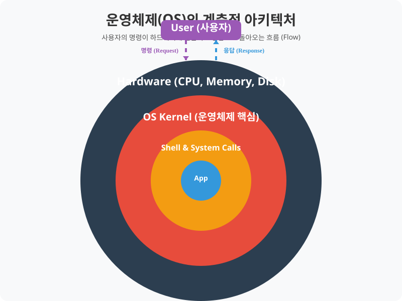

# 1.1 운영체제와 리눅스 소개

우리가 사용하는 컴퓨터는 단순히 철과 플라스틱으로 이루어진 기계 장치인 하드웨어(Hardware) 덩어리에 불과합니다. 여러 사용자가 이 하드웨어를 공유하고, 복잡한 기계어를 몰라도 쉽게 제어할 수 있도록 돕는 것이 바로 **운영체제(Operating System)**입니다.

운영체제는 컴퓨터의 하드웨어와 응용 프로그램(소프트웨어) 간의 인터페이스 역할을 수행하며, 시스템 자원을 가장 효율적으로 분배하고 관리하는 핵심 소프트웨어입니다.

---

## 1. 운영체제란?

운영체제는 사용자가 하드웨어를 직접 제어할 필요 없이 간접적이고 안전하게 컴퓨터 자원을 사용할 수 있도록 도와주는 전체적인 '관리자'입니다. 

> **동작 원리**: 사용자의 명령은 [응용프로그램 -> 쉘 -> 커널 -> 하드웨어] 순으로 전달되며, 작업 처리 결과는 역방향으로 응답됩니다.

### 대표적인 핵심 담당 업무
- **자원 할당 및 스케줄링**: CPU, 메모리 등의 한정된 자원을 배분
- **인터페이스 제공**: 하드웨어 제어를 쉽게 해주는 쉘(Shell) 지원
- **입출력 장치 제어**: 키보드, 마우스, 모니터 통신 
- **컴퓨터 부팅 및 기초 설정**: 시스템 초기화 및 시작 체계 관리

---

## 2. 운영체제의 핵심 역할 및 자원 관리

운영체제는 컴퓨터 시스템의 중재자로서 성능과 안정성을 극대화하기 위해 다음과 같은 5가지 중점 역할을 수행합니다.

### 2.1 프로세서(CPU) 및 다중 프로세스 관리
CPU는 원칙적으로 한 번에 하나의 프로세스만 처리합니다. 여러 프로그램이 동시에 실행되는 것처럼 보이게 만들기 위해, 운영체제는 정교한 **스케줄링(Scheduling)** 알고리즘을 사용합니다. 이를 통해 프로그램 간의 우선순위를 정하고 아주 짧은 시간 단위로 CPU 실행 시간을 쪼개서 분배(Time-sharing)합니다.

### 2.2 메모리(Memory) 할당 및 가상화
운영체제는 프로그램이 실행될 때 필요한 메모리 공간을 **할당(Allocation)**하고, 완료 시 반환받습니다. 특히 여러 큰 프로그램이 켜질 때 실제 물리 램 용량이 부족해지는 것을 막기 위해 하드 디스크의 일부를 메모리처럼 끌어다 쓰는 **가상 메모리(Virtual Memory)** 기술을 활용합니다.

### 2.3 입출력장치 제어 (I/O)
웹캠, 마우스, USB 등 다양한 장치가 충돌 없이 동시에 요청을 처리할 수 있도록 입출력 순서를 조절합니다. 

### 2.4 파일 시스템 구조 관리
데이터들이 하드 디스크 어딘가에 마구잡이로 저장되지 않도록 데이터의 주소와 공간을 트리(Tree) 계층 구조의 디렉터리(폴더)로 묶어 체계적으로 관리합니다.

### 2.5 보안과 접근 제어 
중요한 시스템 파일이나 타인의 공간에 아무나 접근할 수 없도록, 로그인 기반 인증 절차를 거쳐 인가된 사용자(User) 및 그룹(Group)에만 권한(Permission)을 부여합니다.

---

## 3. 운영체제의 네트워크 기능 시스템

과거와 달리 현대 운영체제의 가장 필수적인 요건은 네트워크(Network)를 통해 타 기기와 원활하게 소통하는 것입니다.

### 3.1 통신 프로토콜 지원
데이터를 주고받을 때의 기본 약속인 TCP/IP 환경을 커널 레벨에서 지원합니다. 이 밖에도 웹 구동(HTTP), 파일 전송(FTP) 등 필수적인 데이터 통로를 열어줍니다.

### 3.2 네트워크 설정 및 인터페이스 관리
네트워크 인터페이스 카드(NIC, 통칭 랜카드)와 같은 하드웨어를 즉각적으로 활성화시키고, 장비마다 부여되는 고유 주소인 IP 주소, 서브넷 마스크, 게이트웨이 등을 세팅합니다. 

### 3.3 네트워크 보안 및 모니터링 관리
외부로부터의 비정상적인 침입이나 해킹을 막기 위해 1차적인 **소프트웨어 방화벽** 기능을 수행하며, 데이터 패킷 전송량을 통계적으로 추적하여 네트워크 장애 시 경고를 출력합니다.
