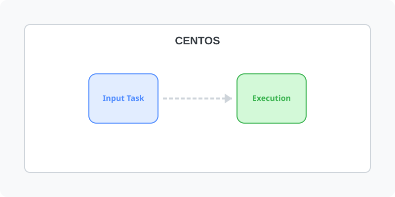

[⬅️ 이전: 컴퓨터의 Bios](../bios/) &nbsp;|&nbsp; [🏠 분류 목차](../../../../) &nbsp;|&nbsp; [다음: 리눅스 배포본 ➡️](../distribution/)

# centos

---

[⬅️ 이전: 컴퓨터의 Bios](../bios/) &nbsp;|&nbsp; [🏠 분류 목차](../../../../) &nbsp;|&nbsp; [다음: 리눅스 배포본 ➡️](../distribution/)
