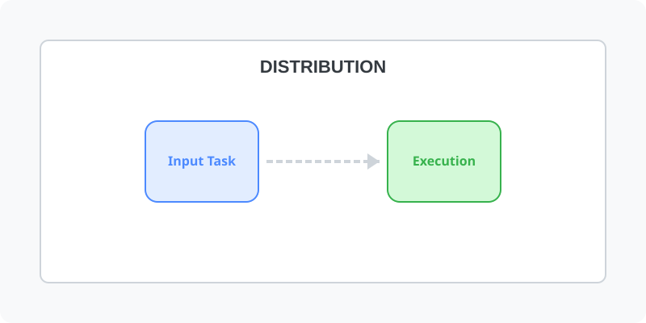

[⬅️ 이전: centos](../centos/) &nbsp;|&nbsp; [🏠 분류 목차](../../../../) &nbsp;|&nbsp; [다음: 양수종 contos ➡️](centos/)

# 리눅스 배포본

* 레드햇 계열
  - RHEL(Red Hat Enterprise Linux)
  - centos
  - Fedora
* Debian 계열
  - Debian
  - [ubuntu](ubuntu)
  - KNOPPIX(CD Linux)
* Slackware
  - OpenSuse

> 맥, 안드로이드도 리눅스 계열의 운영체제를 기반으로 하고 있습니다.

---

[⬅️ 이전: centos](../centos/) &nbsp;|&nbsp; [🏠 분류 목차](../../../../) &nbsp;|&nbsp; [다음: 양수종 contos ➡️](centos/)
