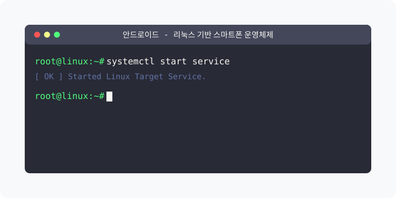

[⬅️ 이전](../) &nbsp;|&nbsp; [🏠 분류 목차](../../../)

# 안드로이드 (Android)

방대한 주제를 분할하여 제공합니다.

## 1️⃣ 핵심 학습 가이드
* [개요](part_1/)

  해당 세부 내용에 대한 튜토리얼을 진행합니다.

* [안드로이드 아키텍처](part_2/)

  해당 세부 내용에 대한 튜토리얼을 진행합니다.

* [안드로이드 시스템 접속](part_3/)

  해당 세부 내용에 대한 튜토리얼을 진행합니다.

## 2️⃣ 심화 및 연계 파트 1
* [안드로이드와 리눅스의 관계](part_4/)

  해당 세부 내용에 대한 튜토리얼을 진행합니다.

* [학습 목표](part_5/)

  해당 세부 내용에 대한 튜토리얼을 진행합니다.

* [실습 과제](part_6/)

  해당 세부 내용에 대한 튜토리얼을 진행합니다.

---

[⬅️ 이전](../) &nbsp;|&nbsp; [🏠 분류 목차](../../../)
