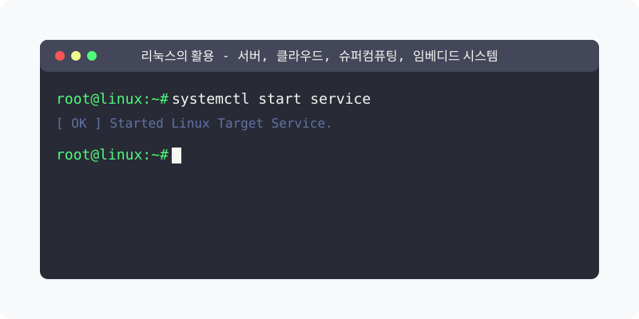

[⬅️ 이전](../) &nbsp;|&nbsp; [🏠 분류 목차](../../../)

# 리눅스의 활용 (Linux Applications)

방대한 주제를 분할하여 제공합니다.

## 1️⃣ 핵심 학습 가이드
* [개요](part_1/)

  해당 세부 내용에 대한 튜토리얼을 진행합니다.

* [서버 분야 Server Applications](part_2/)

  해당 세부 내용에 대한 튜토리얼을 진행합니다.

* [클라우드 분야 Cloud Computing](part_3/)

  해당 세부 내용에 대한 튜토리얼을 진행합니다.

## 2️⃣ 심화 및 연계 파트 1
* [슈퍼컴퓨팅 분야 Supercomputing](part_4/)

  해당 세부 내용에 대한 튜토리얼을 진행합니다.

* [임베디드 시스템 분야 Embedded Systems](part_5/)

  해당 세부 내용에 대한 튜토리얼을 진행합니다.

* [리눅스 활용의 미래 전망](part_6/)

  해당 세부 내용에 대한 튜토리얼을 진행합니다.

## 3️⃣ 심화 및 연계 파트 2
* [학습 목표](part_7/)

  해당 세부 내용에 대한 튜토리얼을 진행합니다.

* [실습 과제](part_8/)

  해당 세부 내용에 대한 튜토리얼을 진행합니다.

* [참고 자료](part_9/)

  해당 세부 내용에 대한 튜토리얼을 진행합니다.

---

[⬅️ 이전](../) &nbsp;|&nbsp; [🏠 분류 목차](../../../)
