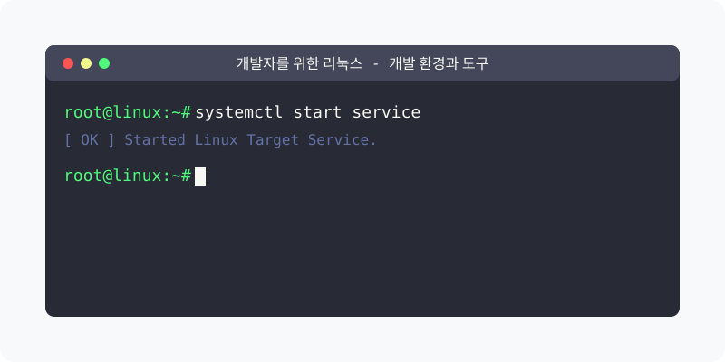

[⬅️ 이전](../) &nbsp;|&nbsp; [🏠 분류 목차](../../../)

# 개발자를 위한 리눅스 (Linux for Developers)

방대한 주제를 분할하여 제공합니다.

## 1️⃣ 핵심 학습 가이드
* [개요](part_1/)

  해당 세부 내용에 대한 튜토리얼을 진행합니다.

* [오픈소스 운영체제](part_2/)

  해당 세부 내용에 대한 튜토리얼을 진행합니다.

* [다양한 개발 도구 지원](part_3/)

  해당 세부 내용에 대한 튜토리얼을 진행합니다.

## 2️⃣ 심화 및 연계 파트 1
* [안정성과 보안성](part_4/)

  해당 세부 내용에 대한 튜토리얼을 진행합니다.

* [높은 성능](part_5/)

  해당 세부 내용에 대한 튜토리얼을 진행합니다.

* [다양한 배포판](part_6/)

  해당 세부 내용에 대한 튜토리얼을 진행합니다.

## 3️⃣ 심화 및 연계 파트 2
* [학습 목표](part_7/)

  해당 세부 내용에 대한 튜토리얼을 진행합니다.

* [실습 과제](part_8/)

  해당 세부 내용에 대한 튜토리얼을 진행합니다.

* [참고 자료](part_9/)

  해당 세부 내용에 대한 튜토리얼을 진행합니다.

---

[⬅️ 이전](../) &nbsp;|&nbsp; [🏠 분류 목차](../../../)
