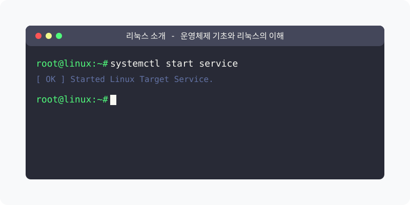

[⬅️ 이전: 1장. 리눅스 소개 및 기초 (Prologue)](../) &nbsp;|&nbsp; [🏠 분류 목차](../../) &nbsp;|&nbsp; [다음: 1.1 운영체제와 리눅스 소개 ➡️](01_1_10_os/)

# 리눅스 소개와 운영체제 기초

우리가 매일 사용하는 스마트폰, 개인용 컴퓨터, 그리고 수많은 인터넷 서비스들은 모두 **운영체제(OS)** 위에서 동작합니다. 현대 IT 인프라와 클라우드 서버 생태계를 지탱하고 있는 핵심 운영체제는 바로 **리눅스(Linux)**입니다. 본 분류에서는 다음과 같은 핵심 개념들을 4개의 테마로 나누어 순차적으로 학습합니다.

소프트웨어를 통제하는 OS의 기본 개념부터 리눅스가 기반을 둔 근간인 유닉스와 핵심 철학을 알아봅니다.

## 1️⃣ 핵심 학습 가이드
* [운영체제(OS) 기초](01_1_10_os/)

  운영체제의 정의와 핵심 역할, 그리고 시스템 자원 통제를 수행하는 구조적인 원리를 학습합니다.

* [유닉스(Unix)란 - 개발자를 위한 리눅스](01_1_13_unix/)

  유닉스 운영체제의 정의, 특징, 사용분야, 종류에 대한 포괄적인 가이드. 멀티유저, 멀티태스킹, 네트워킹, 표준화된 인터페이스 등 유닉스의 핵심 특징을 알아보세요.

* [Solaris - Oracle의 Unix 계열 운영체제](01_1_11_solaris/)

  Solaris는 Oracle에서 개발한 Unix 계열의 서버용 운영체제입니다. 높은 안정성, 보안성, 고성능을 특징으로 하며, DTrace, ZFS 등의 고급 기능을 제공합니다.

* [리눅스의 역사와 철학](01_1_8_linux/)

  리누스 토르발스가 기여한 탄생 스토리와 유닉스 계열 시스템의 파생 철학을 엿봅니다.

* [오픈소스 라이선스 - GPL, Apache2, MIT 라이선스](01_1_9_opensource/)

  오픈소스 라이선스는 소프트웨어의 사용, 수정, 배포를 규정하는 법적 문서입니다. GPL, Apache2, MIT 등 주요 라이선스의 특징과 차이점을 알아보세요.

 

## 2️⃣ 심화 및 연계 파트 1
* [리눅스 커널 - 운영체제의 핵심 구성 요소](01_1_7_kernel/)

  리눅스 커널은 운영체제의 핵심 부분으로, 하드웨어와 소프트웨어 간의 인터페이스를 담당합니다. 커널의 기능, 구조, 오픈소스 특성에 대해 알아보세요.

* [리눅스 운영체제의 구조 - 커널, 쉘, 유틸리티](01_1_12_structure/)

  리눅스 운영체제는 커널, 쉘, 유틸리티의 3부분으로 구성됩니다. 각 구성 요소의 역할과 상호작용에 대해 알아보세요.

* [CLI - Command Line Interface 기초와 리눅스 쉘](01_1_3_cli/)

  CLI(Command Line Interface)는 리눅스 시스템의 핵심 인터페이스입니다. 쉘의 개념, CLI의 특징, 다양한 쉘 종류와 기본 명령어를 알아보세요.

* [X-Window System - 개발자를 위한 리눅스](01_1_14_xwindow/)

  X Window System(X11)의 정의, 아키텍처, 데스크탑 환경, 원격 접속에 대한 포괄적인 가이드. 클라이언트-서버 아키텍처와 GNOME, KDE, Xfce 등 다양한 데스크탑 환경을 알아보세요.

 

* [리눅스 배포판 - 다양한 선택과 특징](01_1_5_distribution/)

  리눅스는 다양한 배포판이 존재하며, 각각의 특징과 용도가 다릅니다. 배포판의 구분, 종류, 선택 기준에 대해 알아보세요.

## 3️⃣ 심화 및 연계 파트 2
* [개발자를 위한 리눅스 - 개발 환경과 도구](01_1_4_develop/)

  리눅스는 개발자들에게 매우 추천되는 운영체제입니다. 오픈소스 특성, 다양한 개발 도구 지원, 안정성과 보안성을 알아보세요.

* [리눅스의 활용 - 서버, 클라우드, 슈퍼컴퓨팅, 임베디드 시스템](01_1_2_application/)

  리눅스는 서버, 클라우드, 슈퍼컴퓨팅, 임베디드 시스템 등 다양한 분야에서 활용되는 범용 운영체제입니다. 각 분야별 리눅스 활용 사례와 특징을 알아보세요.

 

* [안드로이드 - 리눅스 기반 스마트폰 운영체제](01_1_1_android/)

  안드로이드는 리눅스 커널을 기반으로 제작된 스마트폰 운영체제입니다. 안드로이드 아키텍처, 시스템 접속 방법, 리눅스 커널 활용에 대해 알아보세요.

* [IoT와 사물인터넷](01_1_6_iot/)

  초경량화된 리눅스 환경과 센서 기술이 결합되어 실생활의 가전 부품을 통제하는 사물인터넷(Internet of Things) 적용 원리를 이해합니다.

## 2️⃣ 리눅스 시스템 아키텍처
마침내 탄생한 리눅스 운영체제를 구성하는 내부 부품과 명령을 전달하는 통신 방식에 대해 학습합니다.

## 3️⃣ 리눅스 실무 및 개발 환경
커널을 패키징한 배포판의 종류를 알아보고, 현업에서 리눅스가 왜 필수적인 환경인지 살펴봅니다.

## 4️⃣ 리눅스 생태계의 확장
대형 서버망을 넘어 일상생활의 디바이스까지 점령한 리눅스의 파생 생태계를 확인합니다.

---

[⬅️ 이전: 1장. 리눅스 소개 및 기초 (Prologue)](../) &nbsp;|&nbsp; [🏠 분류 목차](../../) &nbsp;|&nbsp; [다음: 1.1 운영체제와 리눅스 소개 ➡️](01_1_10_os/)
