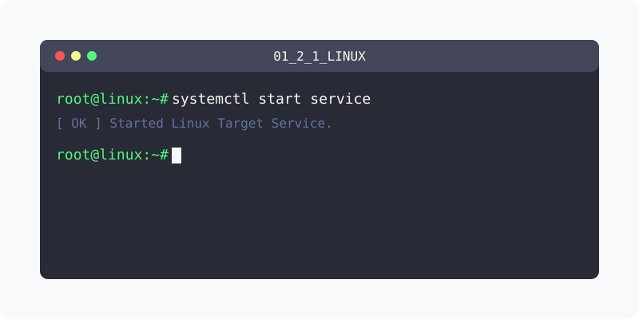

[⬅️ 이전: 1.2 리눅스의 역사와 철학](../) &nbsp;|&nbsp; [🏠 분류 목차](../../../) &nbsp;|&nbsp; [다음: 1.3 X-Window 시스템의 이해와 활용 ➡️](../../01_3_xwindow/)

# 1.2 리눅스의 역사와 철학

리눅스(Linux)는 1991년 핀란드의 대학생이었던 **리누스 토르발스(Linus Torvalds)** 가 개발한 오픈소스 커널입니다. 유닉스(UNIX)와 유사하게 동작하지만 코드를 완전히 새로 작성했으며, 현재는 전 세계 서버와 인프라, 클라우드의 표준으로 자리매김했습니다.

---

## 1. 리눅스의 탄생 배경

당시 대형 컴퓨터 전용이었던 고가의 유닉스(UNIX)를 개인 PC에서 사용하려는 열망이 컸습니다. 

<!-- Broken Image Removed: ../img/linux_history.svg -->
> **흐름도**: UNIX의 구조적 모방에서 시작해 미닉스(MINIX)를 거쳐, 리눅스 커널과 GNU 도구들이 합쳐져 오늘날의 완전한 OS(GNU/Linux)가 완성되었습니다.

### 1.1 유닉스의 한계와 미닉스(MINIX)
- **UNIX (1969)**: 우수한 성능을 가졌으나 상용화되어 라이선스 비용이 천문학적이었습니다.
- **MINIX (1987)**: 앤드류 타넨바움 교수가 교육용으로 만든 소형 유닉스입니다. 소스가 공개되었으나 제약이 있었고, 기능적으로 부족함이 많았습니다.

### 1.2 리눅스 커널의 탄생
- 미닉스에 만족하지 못한 리누스 토르발스가 1991년에 취미 삼아 독자적인 커널(Kernel 0.01)을 작성하여 인터넷에 무료로 배포한 것이 리눅스의 시초입니다.

---

## 2. GNU 프로젝트와의 결합

리눅스만으로는 단순히 핵심 '커널'일 뿐 작동하는 완전한 운영체제가 될 수 없었습니다. 여기에 생명을 불어넣은 것이 바로 **GNU 프로젝트**입니다.

### 2.1 자유 소프트웨어 재단 (FSF)
- 리처드 스톨만(Richard Stallman)이 주도한 GNU(GNU is Not Unix) 프로젝트는 유닉스와 완벽하게 호환되면서도 누구나 무료로 쓸 수 있는 "자유 소프트웨어"를 생산하기 시작했습니다.
- GCC 컴파일러, bash 쉘, 각종 필수 터미널 명령어(ls, mv 등)를 개발했습니다.

### 2.2 GNU/Linux의 완성 
- GNU 프로젝트는 쓸만한 도구는 다 만들었지만 이 도구들이 올라갈 핵심 '커널'이 없었고, 리누스 토르발스의 '리눅스 커널'은 명령어를 실행해 줄 '도구'가 부족했습니다.
- 1992년, 리눅스 커널이 GNU의 **GPL 라이선스(자유롭게 복제 및 수정 가능한 라이선스)**를 채택하면서, 두 생태계가 결합된 `GNU/Linux` 가 탄생했습니다. (하지만 사람들은 짧게 '리눅스'라고 부릅니다.)

---

## 3. 오픈소스 정신 (Open Source)

리눅스의 거대한 성공은 소스코드가 완전하게 개방된 **오픈소스 생태계** 덕분입니다.

- **집단 지성**: 수많은 전 세계 개발자들이 인터넷을 통해 자발적으로 버그를 수정하고 기여합니다.
- **포크(Fork)와 배포판(Distribution)**: 코드가 열려 있으므로 레드햇, 우분투, 데비안 등 수백 가지의 파생 '리눅스 배포판'이 탄생할 수 있었습니다.
- **플랫폼 독립성**: 오픈소스 구조로 인해 인텔 CPU는 물론 스마트폰(안드로이드), 공유기(ARM), 슈퍼컴퓨터 등 거의 모든 환경에 이식되었습니다.

---

[⬅️ 이전: 1.2 리눅스의 역사와 철학](../) &nbsp;|&nbsp; [🏠 분류 목차](../../../) &nbsp;|&nbsp; [다음: 1.3 X-Window 시스템의 이해와 활용 ➡️](../../01_3_xwindow/)
