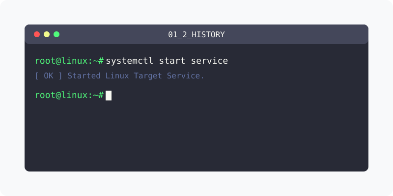

[⬅️ 이전: 오픈소스 라이선스 - GPL, Apache2, MIT 라이선스](../01_1_prologue/01_1_9_opensource/) &nbsp;|&nbsp; [🏠 분류 목차](../../) &nbsp;|&nbsp; [다음: 1.2 리눅스의 역사와 철학 ➡️](01_2_1_linux/)

# 1.2 리눅스의 역사와 철학

리눅스(Linux)는 1991년 핀란드의 대학생이었던 **리누스 토르발스(Linus Torvalds)** 가 개발한 오픈소스 커널입니다. 유닉스(UNIX)와 유사하게 동작하지만 코드를 완전히 새로 작성했으며, 현재는 전 세계 서버와 인프라, 클라우드의 표준으로 자리매김했습니다.

---

본 과정에서는 리눅스가 탄생하기까지의 시대적 배경(유닉스와 미닉스의 한계)을 짚어보고, 소스코드를 개방하는 오픈소스 철학과 결합하여 글로벌 생태계를 장악하게 된 위대한 여정을 학습합니다.

## 1️⃣ 탄생과 철학 가이드
유닉스에서 파생되어 세상에 나오기까지 리눅스가 걸어온 역사의 발자취를 추적합니다.

* [리눅스의 역사와 오픈소스 정신 깊이보기](01_2_1_linux/)

  초기 폐쇄적이었던 유닉스와 미닉스의 한계에서 출발하여, 리누스 토르발스의 0.01 커널 및 GNU 프로젝트와 결합함으로써 오늘날의 위대한 오플소스 생태계를 구축하게 된 핵심 역사 스토리를 학습합니다.

---

[⬅️ 이전: 오픈소스 라이선스 - GPL, Apache2, MIT 라이선스](../01_1_prologue/01_1_9_opensource/) &nbsp;|&nbsp; [🏠 분류 목차](../../) &nbsp;|&nbsp; [다음: 1.2 리눅스의 역사와 철학 ➡️](01_2_1_linux/)
