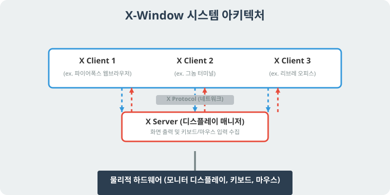

[⬅️ 이전: 1.3 X-Window 시스템의 이해와 활용](../) &nbsp;|&nbsp; [🏠 분류 목차](../../../) &nbsp;|&nbsp; [다음: 데스크톱 환경 및 설정 ➡️](../01_3_1_setting/)

# X-Window 시스템의 아키텍처와 개념

본래 리눅스는 커맨드 라인(CLI) 기반으로 텍스트만 출력되는 척박한 운영체제였습니다. 하지만 사람들은 그래픽(GUI) 아이콘과 마우스가 존재하는 윈도우 환경을 원했고, 리눅스에 그래픽을 입히기 위해 고안된 구조가 바로 **X-Window 시스템**입니다.

## 1. X-Window의 아키텍처

윈도우(Windows)나 맥(macOS)은 운영체제 자체가 바탕화면과 그래픽 기능을 내장하고 있습니다. 그러나 리눅스는 커널과 그래픽 시스템이 철저하게 분리되어 있습니다. 리눅스의 X-Window는 독특하게도 자체적인 **네트워크 서버-클라이언트 아키텍처**를 가집니다.

> **동작 원리**: 그래픽을 뿌려주는 'X 서버'와, 창을 하나하나 띄워달라고 요청하는 응용프로그램인 'X 클라이언트'가 서로 네트워크 통신을 하며 바탕화면을 그려냅니다.

### 1.1 X Server (X 서버)
- 모니터에 그림을 그리고, 사용자의 키보드나 마우스 입력을 받아들이는 하드웨어 제어 중계자입니다.
- 리눅스 그래픽 화면 그 자체를 돌리기 위해 떠 있는 백그라운드 관리 서버라고 볼 수 있습니다.

### 1.2 X Client (X 클라이언트)
- 우리가 흔히 실행하는 파이어폭스 브라우저, 터미널 창, 리브레 오피스 등의 응용 프로그램입니다.
- 이들은 스스로 화면에 그림을 그리지 않고, "가로 300 세로 200짜리 파란색 창을 띄워 줘"라고 **X 서버에 요청(Request)** 만 합니다.

### 1.3 X Protocol 
- X 클라이언트와 X 서버가 대화하는 통신 규약입니다. 
- 이 점이 강력한 이유는 두 개체 간 통신이 **네트워크를 넘어서도** 가능하기 때문입니다. 즉, 원격에 있는 서버의 파이어폭스 브라우저 로딩 화면을 내 로컬 PC의 모니터(X 서버)에 띄우는 것이 가능합니다. (X11 포워딩 기술)

---

## 2. 응용 프로그램 환경 구축 (데스크톱 환경)

X-Window는 단지 도화지와 펜을 열어줄 뿐이며, 여기에 시작 버튼, 툴바, 화려한 아이콘 등을 올려 꾸며주는 거대한 세트를 **데스크톱 환경(Desktop Environment, DE)** 이라고 부릅니다.

### 2.1 대표적인 데스크톱 환경
- **GNOME (그놈)**: 우분투(Ubuntu) 등 가장 널리 쓰이는 리눅스의 기본 테마이자 환경입니다. 직관적이고 무겁지만 안정적입니다.
- **KDE Plasma**: 윈도우와 디자인이 매우 흡사하고 화려하며 커스터마이징이 극대화된 환경입니다.
- **XFCE**: 사양이 낮은 리눅스나 라즈베리파이 등에서 주로 사용하는 아주 가벼운 경량 환경입니다.

---

## 3. 리눅스의 필수 그래픽 응용 프로그램

리눅스의 X-Window가 켜지면 윈도우 환경 부럽지 않은 다양한 실무 툴을 사용할 수 있습니다.

### 3.1 파일 관리와 인터넷
- **파일 관리자 (노틸러스, Nautilus)**: 윈도우 탐색기와 똑같이 디렉터리를 더블클릭해서 관리합니다.
- **웹 브라우저**: 파이어폭스(Firefox) 등이 보통 초기 탑재되어 있으며, 구글 크롬 설치도 가능합니다.

### 3.2 오피스와 보조 프로그램
- **리브레 오피스 (LibreOffice)**: 엑셀, 파워포인트, 워드를 완벽히 대체하는 무료 오피스 제품군입니다.
- **소프트웨어 센터 (Software Center)**: 스마트폰의 앱스토어처럼, 한 번의 클릭으로 패키지와 의존성 프로그램들을 설치하게 해 주는 GUI 스토어입니다.

---

[⬅️ 이전: 1.3 X-Window 시스템의 이해와 활용](../) &nbsp;|&nbsp; [🏠 분류 목차](../../../) &nbsp;|&nbsp; [다음: 데스크톱 환경 및 설정 ➡️](../01_3_1_setting/)
