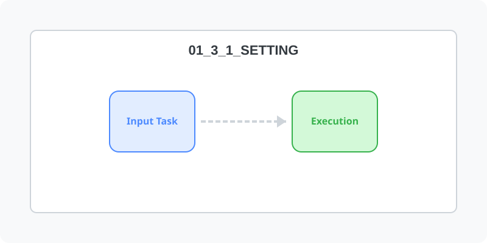
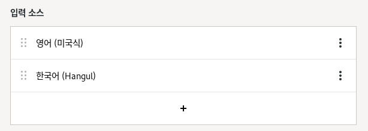

[⬅️ 이전: 1.3 X-Window 시스템의 이해와 활용](../) &nbsp;|&nbsp; [🏠 분류 목차](../../../) &nbsp;|&nbsp; [다음: 2장. 리눅스 설치 및 환경 설정 (Setup) ➡️](../../../02_setup/)



# 설정

## 업데이트 비활성화
```
gsettings set org.gnome.software download-updates false
```

```
systemctl disable dnf-makecache.service
systemctl disable dnf-makecache.timer
```

## 키보드 설정

한글과 영문이 모두 작성이 가능하도록 환경설정에서 키보드 설정을 합니다.

기존의 키보드 입력을 삭제하시고, 다음과 같이 2개의 키보드를 선택합니다.



> 한영전환은 `shift`+`space`키를 누르면 한/영이 변환됩니다.

---

[⬅️ 이전: 1.3 X-Window 시스템의 이해와 활용](../) &nbsp;|&nbsp; [🏠 분류 목차](../../../) &nbsp;|&nbsp; [다음: 2장. 리눅스 설치 및 환경 설정 (Setup) ➡️](../../../02_setup/)
