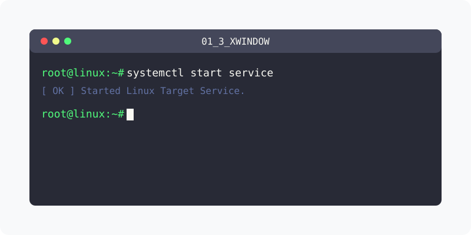

[⬅️ 이전: 1.2 리눅스의 역사와 철학](../01_2_history/01_2_1_linux/) &nbsp;|&nbsp; [🏠 분류 목차](../../) &nbsp;|&nbsp; [다음: 설정 ➡️](01_3_1_setting/)

# 1.3 X-Window 시스템의 이해와 활용

본 파트에서는 척박한 터미널 커맨드 라인을 넘어서 리눅스 운영체제에 화려한 그래픽을 덧입히는 X-Window 시스템의 근간 구조와 그 활용법을 학습합니다.

## 1️⃣ 그래픽 시스템의 이해와 분리 구조
서버-클라이언트 통신 구조로 독특하게 분리되어 있는 리눅스의 그래픽 동작 개념을 알아봅니다.

* [X-Window 시스템 기초 아키텍처](01_3_0_concept/)

  X 클라이언트와 X 서버가 네트워크(X Protocol)를 통해 서로 그래픽을 송수신하는 과정의 개념을 이해하고, 세계적으로 널리 쓰이는 데스크톱 환경(GNOME, KDE) 운영 체제를 숙지하는 기본 과정입니다.

 

## 2️⃣ 그래픽 시스템 실무 및 설정
윈도우 환경과 유사한 기능을 확보하기 위한 세팅을 진행합니다.

* [데스크톱 환경 앱 설정법](01_3_1_setting/)

  리눅스를 일반 PC나 데스크탑용으로 사용하기 위한 필수 소프트웨어 활용 방법과 자동 업데이트 비활성화 등 필수 설정 요령을 실습합니다.

---

[⬅️ 이전: 1.2 리눅스의 역사와 철학](../01_2_history/01_2_1_linux/) &nbsp;|&nbsp; [🏠 분류 목차](../../) &nbsp;|&nbsp; [다음: 설정 ➡️](01_3_1_setting/)
