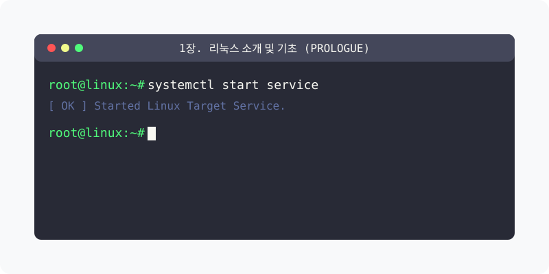

[🏠 분류 목차](../) &nbsp;|&nbsp; [다음: 리눅스 소개 - 운영체제 기초와 리눅스의 이해 ➡️](01_1_prologue/)

# 1장. 리눅스 소개 및 기초 (Prologue)

리눅스와 운영체제의 기본적인 개념을 학습하고, 리눅스의 역사와 철학, 그리고 그래픽 사용자 인터페이스(X-Window) 환경을 다루는 과정을 시작합니다.

## 세부 학습 목차

* [1.1 운영체제 기초 및 리눅스 이해](01_1_prologue/)

  운영체제의 정의와 역할부터 시작해 하드웨어/소프트웨어 간 인터페이스의 통제 과정을 배웁니다. 유닉스와의 관계, 오픈소스 배포판(우분투, CentOS 등)의 종류와 특성 등을 포괄적으로 다룹니다.

* [1.2 리눅스의 역사와 철학](01_2_history/)

  1991년 미닉스(MINIX)의 한계에서 시작된 창작물이었던 리눅스 커널이 GNU 등 자유 소프트웨어(오픈소스) 운동과 결합해 전 세계 서버 인프라를 지배하게 된 탄생 스토리와 그 철학을 이해합니다.

* [1.3 리눅스의 GUI, X-Window 시스템](01_3_xwindow/)

  CLI(Command Line Interface)가 아닌 그래픽 데스크톱 환경에서 사용자 입력을 관리하는 리눅스의 핵심 그래픽 시스템(GUI)이자 윈도우 시스템 툴킷인 X-Window의 작동 원리를 살펴봅니다.

---

[🏠 분류 목차](../) &nbsp;|&nbsp; [다음: 리눅스 소개 - 운영체제 기초와 리눅스의 이해 ➡️](01_1_prologue/)
