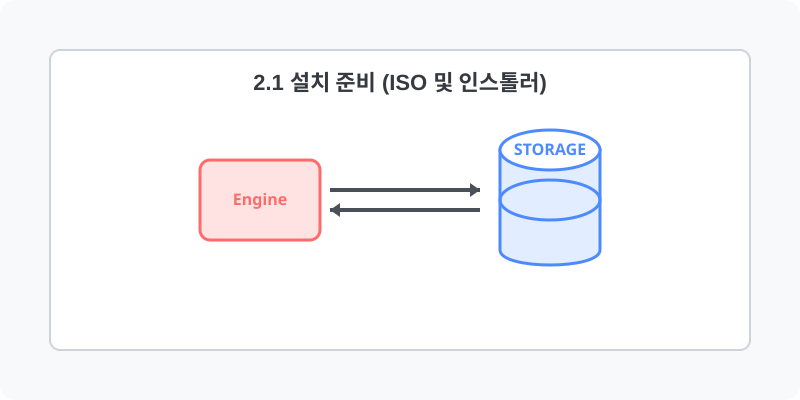

[⬅️ 이전: 2장. 리눅스 설치 및 환경 설정 (Setup)](../) &nbsp;|&nbsp; [🏠 분류 목차](../../) &nbsp;|&nbsp; [다음: 인스톨러 ➡️](02_1_1_installer/)

# 2.1 설치 준비 (ISO 및 인스톨러)

모든 운영체제의 설치는 하드웨어가 읽을 수 있는 설치 디스크 이미지와, 설치 프로세스를 초기화해주는 인스톨러 프로그램에서 시작됩니다. 이 장에서는 리눅스를 설치하기 전 필수적으로 알아야 할 두 가지 핵심 요소를 학습합니다.

## 세부 학습 내용

* [ISO 이미지 (ISO Image) 이해](02_1_2_iso/)

  운영 체제 설치 파일이 묶음 포장되어 있는 단일 디스크 이미지(ISO)의 구조와 파일 추출 원리에 대해 배웁니다.

* [설치 인스톨러 (Installer) 프로세스](02_1_1_installer/)

  화면 출력과 키보드 입력을 통해 각 배포판에서 제공하는 설치 프로그램이 시스템 디스크 영역을 논리적으로 분할하고 구성하는 과정을 학습합니다.

---

[⬅️ 이전: 2장. 리눅스 설치 및 환경 설정 (Setup)](../) &nbsp;|&nbsp; [🏠 분류 목차](../../) &nbsp;|&nbsp; [다음: 인스톨러 ➡️](02_1_1_installer/)
