[⬅️ 이전](../) &nbsp;|&nbsp; [🏠 분류 목차](../../../)

# 2.2 우분투(Ubuntu) 환경 구축 완전 튜토리얼

Ubuntu 24.04 LTS (Noble Numbat)는 2024년 4월에 출시된 최신 장기 지원 버전입니다. 이 가이드를 통해 물리적(Bare-metal) 설치, 가상머신(VM), 그리고 윈도우 서브시스템(WSL) 환경에서 Ubuntu를 완벽하게 설치하고 설정하는 방법을 학습합니다.

> **설치 원리**: 빈 깡통 상태인 가상머신(Virtual Machine)을 생성한 뒤, `.iso` 포맷으로 된 우분투 설치 CD 이미지를 가상 CD-ROM에 삽입하여 가상 하드디스크에 운영체제를 설치하는 과정을 거칩니다.

방대한 주제를 분할하여 제공합니다.

## 1️⃣ 핵심 학습 가이드
* [1 Ubuntu 2404 LTS 소개](part_1/)

  해당 세부 내용에 대한 튜토리얼을 진행합니다.

* [2 설치 미디어 ISO 준비](part_2/)

  해당 세부 내용에 대한 튜토리얼을 진행합니다.

* [3 Ubuntu 설치 진행](part_3/)

  해당 세부 내용에 대한 튜토리얼을 진행합니다.

## 2️⃣ 심화 및 연계 파트 1
* [4 Ubuntu 설치 완료 후 기본 설정](part_4/)

  해당 세부 내용에 대한 튜토리얼을 진행합니다.

* [5 설치 확인 및 트러블슈팅](part_5/)

  해당 세부 내용에 대한 튜토리얼을 진행합니다.

---

[⬅️ 이전](../) &nbsp;|&nbsp; [🏠 분류 목차](../../../)
