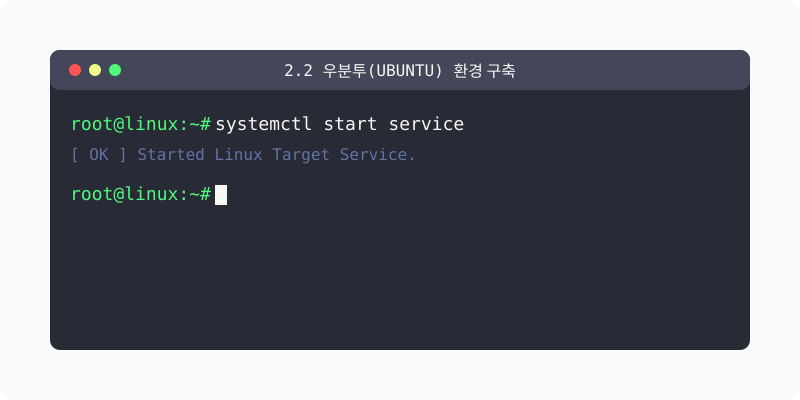

[⬅️ 이전: 설치 미디어](../02_1_prepare/02_1_2_iso/) &nbsp;|&nbsp; [🏠 분류 목차](../../) &nbsp;|&nbsp; [다음: ubuntu 설치 이미지 만들기 ➡️](02_2_1_iso/)

데스크톱용 리눅스의 전 세계적인 표준으로 불리는 우분투(Ubuntu) 24.04 LTS 버전을 다운로드하고 가상 머신에 구축하는 전체 프로세스를 안내하는 허브 챕터입니다.

## 1️⃣ Ubuntu 시스템 이해 및 튜토리얼
우분투 운영체제의 하드웨어 요구사항과 초기 설정 튜토리얼을 짚어봅니다.

* [우분투 설치 완전 튜토리얼 및 기본 설정](02_2_0_concept/)

  ISO 이미지를 가상머신이나 WSL에 마운트하여 우분투를 최초 설치하는 A to Z 과정과, 설치 직후 필수적으로 수행해야 하는 시스템 패키지 초기 갱신(`apt update`) 및 기본 보안 방화벽 활성화 요령을 살펴봅니다.

 

## 2️⃣ 설치 파일 커스텀 응용
ISO 파일 내부 구조를 변제하고 재압축하는 응용 지식을 다룹니다.

* [우분투 커스텀 설치 이미지(ISO) 제작 실습](02_2_1_iso/)

  단순한 공식 다운로드판이 아니라, 자신만의 목적이나 조직 배포 용도에 맞게 사전 셋팅(프리셋)을 마친 응용 자체 ISO 미디어를 패키징하고 추출해 내는 고도의 테크닉을 익힙니다.

[⬅️ 이전: 설치 미디어](../02_1_prepare/02_1_2_iso/) &nbsp;|&nbsp; [🏠 분류 목차](../../) &nbsp;|&nbsp; [다음: ubuntu 설치 이미지 만들기 ➡️](02_2_1_iso/)
