# 2.2 우분투(Ubuntu) 환경 구축 완전 튜토리얼

Ubuntu 24.04 LTS (Noble Numbat)는 2024년 4월에 출시된 최신 장기 지원 버전입니다. 이 가이드를 통해 물리적(Bare-metal) 설치, 가상머신(VM), 그리고 윈도우 서브시스템(WSL) 환경에서 Ubuntu를 완벽하게 설치하고 설정하는 방법을 학습합니다.


> **설치 원리**: 빈 깡통 상태인 가상머신(Virtual Machine)을 생성한 뒤, `.iso` 포맷으로 된 우분투 설치 CD 이미지를 가상 CD-ROM에 삽입하여 가상 하드디스크에 운영체제를 설치하는 과정을 거칩니다.

## 1. Ubuntu 24.04 LTS 소개

Ubuntu 24.04 LTS는 전 세계에서 가장 대중적으로 사용되는 데스크톱 및 서버용 데비안(Debian) 계열 리눅스 배포판입니다.

### 1.1 주요 특징
- **장기 지원(LTS)**: 2029년 4월까지 5년간 공식 보안 지원
- **사용자 편의성**: 가장 직관적이고 윈도우와 유사한 GNOME 데스크톱 지원
- **최신 기술**: 최신 하드웨어 지원 및 개발자 친화적인 소프트웨어 스택 제공

### 1.2 시스템 요구사항 (권장 사양)
- **CPU**: 2GHz 쿼드코어 프로세서 이상 (64비트)
- **RAM**: 8GB 이상
- **저장공간**: 100GB 이상 (가상 머신 구동 시 SSD 권장)

---

## 2. 설치 미디어 (ISO) 준비

컴퓨터나 가상머신에 리눅스를 설치하려면 설치 CD 원본인 `.iso` 아카이브 파일이 필요합니다.

### 2.1 ISO 이미지 다운로드
공식 또는 한국 내 미러 사이트에서 다운로드하면 속도가 빠릅니다.
- **Ubuntu 공식**: [releases.ubuntu.com/24.04/](https://releases.ubuntu.com/24.04/)
- **카카오 미러**: [mirror.kakao.com/ubuntu-releases/](https://mirror.kakao.com/ubuntu-releases/noble/)

### 2.2 물리적 설치를 위한 USB 부팅 미디어 생성 (Windows 환경)
서버 PC 등 깡통 하드웨어에 직접 설치하려면 USB를 구워야 합니다.
1. [Rufus](https://rufus.ie/) 프로그램 다운로드 및 실행
2. 빈 USB 메모리 연결
3. 다운로드한 `ubuntu-24.04-desktop-amd64.iso` 파일 선택 및 생성 시작

---

## 3. Ubuntu 설치 진행

목적에 맞춰 세 가지 환경 중 하나를 선택해 설치합니다. 본 실습에서는 주로 **가상머신 방식**을 추천합니다.

### 3.1 가상머신 (VirtualBox / VMware)에 설치
가상머신을 구동해 내 PC 안에 띄우는 방식입니다.
1. VirtualBox(또는 VMware) 실행 후 **새 가상머신 (New)** 생성
2. 메모리(RAM) 4GB, 디스크 용량 50GB 이상 할당
3. 생성된 가상머신 설정에서 **저장소(Storage) -> 광학 드라이브**에 다운로드한 우분투 `.iso` 파일 삽입
4. 가상머신 시작을 누르면 우분투 로고가 뜨며 설치 화면 진입

### 3.2 윈도우 서브시스템 (WSL2) 환경에 설치
무거운 가상머신 없이 윈도우 환경에 리눅스 셸만 빠르게 띄우는 개발자용 방식입니다. (Powershell 관리자 권한 실행)
```bash
# Windows에서 WSL 및 우분투 24.04 즉시 설치
wsl --install -d Ubuntu-24.04

# WSL2 버전 활성화 확인
wsl -l -v
```

### 3.3 물리 장비 (Bare-metal) 설치 절차 
만약 진짜 컴퓨터 포맷 후 설치한다면 아래와 같습니다.
1. F2/Del 키로 BIOS 진입 -> USB를 첫 번째 부팅 순서로 변경
2. 언어(한국어) 및 디스크 파티션(디스크 지우고 Ubuntu 설치) 선택
3. 사용자명 및 비밀번호 계정 설정 대기

---

## 4. Ubuntu 설치 완료 후 기본 설정

설치가 끝나고 바탕화면(또는 터미널)에 접속했다면 가장 먼저 시스템을 최신 상태로 업데이트해야 합니다. 터미널을 열고 다음 명령어들을 순서대로 입력하세요.

### 4.1 시스템 업데이트 및 업그레이드
```bash
# 원격 저장소에서 패키지 목록의 버전들을 최신으로 갱신
sudo apt update

# 실제로 컴퓨터에 깔린 패키지들을 최신 버전으로 업그레이드
sudo apt upgrade -y

# 업그레이드 후 남은 불필요한 찌꺼기 패키지 자동 제거
sudo apt autoremove -y
```

### 4.2 필수 유틸리티 및 개발 환경 설치
리눅스 서버 운영과 프로그래밍에 뼈대가 되는 최소 도구들을 설치해 둡니다.
```bash
# 텍스트 에디터, 네트워크 도구 모니터링 도구 
sudo apt install vim git curl wget htop -y

# 기본 컴파일러 시스템과 파이썬/노드 
sudo apt install build-essential python3-pip nodejs npm -y
```

### 4.3 방화벽(UFW) 기본 보안 세팅
서버로 운영할 계획이 있다면 불필요한 접속을 차단해야 합니다.
```bash
# 방화벽 활성화 (주의: 원격 환경일 경우 ssh가 막히지 않게 조치)
sudo ufw enable

# 웹(http) 및 원격접속(ssh) 포트만 허용
sudo ufw allow ssh
sudo ufw allow http
sudo ufw allow https
```

## 5. 설치 확인 및 트러블슈팅

시스템이 정상 설치되었는지 버전 정보를 출력하여 검증합니다.
```bash
# Ubuntu 배포판 버전 확인
lsb_release -a
# 커널 버전 확인
uname -r
```

> **부팅 문제 발생 시**: 가상머신에서 AMD-V 또는 VT-x 가상화 기능이 BIOS에서 켜져 있는지 확인하고 리소스(RAM)를 넉넉하게 재할당해 보세요.