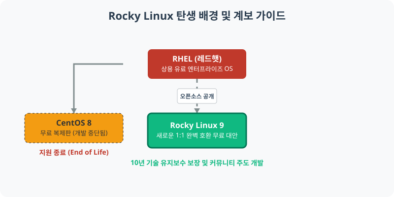
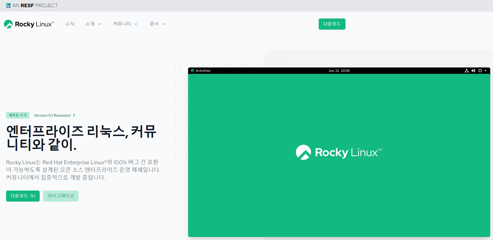

[⬅️ 이전: 서버용 Rocky Linux 기초](../) &nbsp;|&nbsp; [🏠 분류 목차](../../../) &nbsp;|&nbsp; [다음: 2.1 리눅스 설치 및 가상화의 이해 ➡️](../../02_4_virtual/)

# 2.3 로키(Rocky) 리눅스 환경 세팅 및 이해

로키 리눅스(Rocky Linux)는 서버 시장을 장악했던 전설적인 무료 상업용 서버 OS인 **CentOS 8이 강제로 단종된 이후, 그 대안으로 새롭게 개발된 무료 엔터프라이즈 기반의 리눅스 배포판**입니다. 

---

## 1. 로키 리눅스 탄생 배경


> **흐름도**: 막대한 비용을 내는 유료 상용 OS인 RHEL(Red Hat)의 무료 쌍둥이 버전이었던 CentOS가 갑작스레 운영을 중단하면서, 똑같은 방식으로 코드를 복제해 만든 새로운 대체제가 바로 Rocky Linux입니다.

### 1.1 CentOS 개발 중단 사태와 그레고리 커처
Gregory Kurtzer(그레고리 커처)는 애초에 CentOS 프로젝트를 창시한 초기 개발자 중 한 명이었습니다. 하지만 거대 기업인 Red Hat 측이 CentOS의 전통적인 개발을 중단시켜 버리고 실시간 불안정 버전(CentOS Stream)으로 전환하자, 기존에 안정적으로 서버를 돌리던 개발자들은 엄청난 혼란에 빠졌습니다.

*기존 Gregory Kurtzer 인물 사진 기록 유지:*
> 

### 1.2 대안을 향한 새로운 프로젝트의 출범
이에 Gregory Kurtzer는 Red Hat Enterprise Linux(RHEL)의 소스 코드를 이전과 같이 그대로 컴파일하여 **100% 호환되는 진정한 커뮤니티 주도 OS**를 만들기로 선언했고, 그렇게 탄생한 것이 바로 **Rocky Linux**입니다. 현재 수많은 기업과 데이터 센터들이 CentOS를 버리고 Rocky Linux로 이주했습니다.

---

## 2. 다운로드 및 공식 정보

### 2.1 로키 리눅스 공식 사이트
로키 리눅스와 릴리즈 노트, 미러 정보를 제공하는 공식 웹 페이지는 [`https://rockylinux.org/ko/`](https://rockylinux.org/ko/) 입니다.
> 

### 2.2 설치 미디어 (ISO) 다운로드
설치를 위해 공식 사이트를 통하거나 아래 다이렉트 링크 (국내 미러 혹은 기본 서버)를 통해 배포본의 이미지 파일(`*.iso`)을 다운로드 받을 수 있습니다.
- [로키리눅스 9.x DVD ISO 공식 다운로드소](https://dl.rockylinux.org/vault/rocky/9.0/isos/x86_64/Rocky-9.0-x86_64-dvd.iso)

*(버전은 지속 업데이트되므로 항상 공식사이트의 최신 안정(Stable) 버전을 권장합니다.)*

---

## 3. 로키 리눅스 9 설치 요약

로키 리눅스도 우분투와 마찬가지로 로컬 하드웨어나 VirtualBox 같은 가상 머신(VM)에 설치합니다.

### 3.1 주요 설치 과정
1. **미디어 부팅**: 다운로드 받은 `.iso` 파일을 가상 머신에 삽입한 뒤 전원을 켭니다. 
2. **Anaconda 인스톨러 구동**: 우분투와 약간 다르게 Red Hat 계열 특유의 '아나콘다(Anaconda)' 시각적 설치 인스톨러가 등장합니다.
3. **소프트웨어 선택 (중요)**: 서버(Server) 모드인지, 혹은 눈에 보이는 GUI가 포함된 워크스테이션 모드인지 소프트웨어 베이스를 결정해야 합니다. 초기 학습자는 **[Server with GUI]** 를 보통 선택합니다.
4. **파티셔닝**: `루트 ( / )` 파티션과 가상 메모리인 `스왑 (swap)` 위치를 할당합니다.
5. **계정 세팅**: 최고 자격 관리자인 `root` 비밀번호를 지정하고 일반 사용자(user)도 추가해 둡니다.

---

## 4. 설치 후 터미널 작동 확인 가이드

설치 완료 로고가 뜨고 첫 부팅 단계를 밟았다면 터미널 창을 열어 아래 기본 정보들을 조회하며 정상 동작을 확인합니다.

### 4.1 릴리즈 버전 확인 명령어
```bash
# 로키 리눅스의 정확한 배포판 명과 버전 표시
cat /etc/os-release

# 또는 RHEL 호환 버전 표시
cat /etc/redhat-release
```

### 4.2 시스템 및 패키지 관리자 초기화
우분투의 `apt`와 달리 로키 등 레드햇 계열 서버들은 `dnf` 패키지 관리자를 씁니다. 최초 설치 후 이들을 전체 동기화해 줍니다.
```bash
# 로키 리눅스 9 시스템의 모든 구성 요소 최신 버전 갱신
sudo dnf update -y
```

---

[⬅️ 이전: 서버용 Rocky Linux 기초](../) &nbsp;|&nbsp; [🏠 분류 목차](../../../) &nbsp;|&nbsp; [다음: 2.1 리눅스 설치 및 가상화의 이해 ➡️](../../02_4_virtual/)
