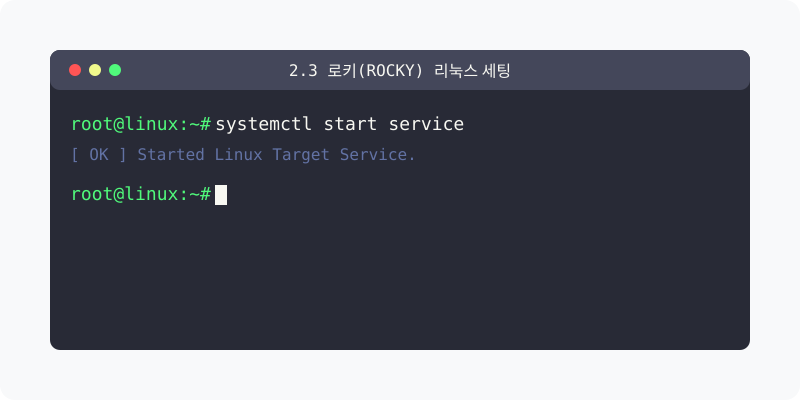

[⬅️ 이전: ubuntu 설치 이미지 만들기](../02_2_ubuntu/02_2_1_iso/) &nbsp;|&nbsp; [🏠 분류 목차](../../) &nbsp;|&nbsp; [다음: 2.1 리눅스 설치 및 가상화의 이해 ➡️](../02_4_virtual/)

전통적 서버 시장을 장악했던 RHEL 체계를 100% 호환하는 기업형 배포판, 로키 리눅스(Rocky Linux)의 인스톨 과정을 다루는 허브 챕터입니다.

## 1️⃣ 로키 리눅스 기원과 설치
레드햇(Red Hat) 생태계에서 파생된 역사적 배경과 아나콘다(Anaconda) 설치 시스템을 알아봅니다.

* [로키 리눅스 탄생 배경 및 세팅 튜토리얼](02_3_0_concept/)

  명정했던 CentOS가 강제 종료되고 그 대안으로 출범한 Rocky Linux의 흥미로운 역사 스토리를 역추적 한 뒤, ISO 미디어를 통해 패키징 환경을 선택하고 `dnf` 패키지 매니저로 첫 환경을 초기화하는 실무 서버 구축법을 익힙니다.

[⬅️ 이전: ubuntu 설치 이미지 만들기](../02_2_ubuntu/02_2_1_iso/) &nbsp;|&nbsp; [🏠 분류 목차](../../) &nbsp;|&nbsp; [다음: 2.1 리눅스 설치 및 가상화의 이해 ➡️](../02_4_virtual/)
