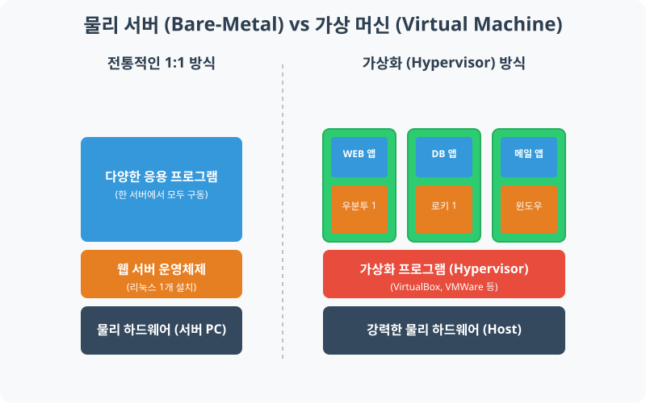

[⬅️ 이전: 가상화 시스템 환경](../) &nbsp;|&nbsp; [🏠 분류 목차](../../../) &nbsp;|&nbsp; [다음: VirtualBox 실습 ➡️](../02_4_1_virtualbox/)

# 2.4 가상화(Virtualization)의 이해

리눅스를 학습하기 위해서는 운영체제를 설치하고 실습할 환경이 필요합니다. 과거에는 별도의 빈 컴퓨터(서버 하드웨어)를 구해서 리눅스를 단일로 설치(Bare-metal 방식)해야 했지만, 오늘날에는 내 방의 윈도우 컴퓨터 안에서 가짜 컴퓨터 여러 대를 만들어 리눅스를 돌릴 수 있는 **가상화(Virtualization)** 기술을 대중적으로 사용합니다.

---

## 1. 물리 서버 vs 가상화 서버

> **동작 원리**: 하이퍼바이저(Hypervisor)라는 중간 관리자가 물리적은 본체 하나를 논리적으로 쪼개어 가짜 컴퓨터(VM) 여러 대를 만들어냅니다.

### 1.1 전통적 배어메탈(Bare-Metal) 방식
- **구조**: `PC 1대 + OS 1개 + 프로그램들`
- **단점**: 하드웨어가 1개의 OS에 매우 종속되며, 프로그램 하나가 치명적인 오류를 내면 OS 전체가 멈춰버립니다(웹 서버와 DB 서버가 동반 다운됨).

### 1.2 가상화(Virtualization) 환경 방식
- **구조**: `PC 1대 + 하이퍼바이저 + (VM1, VM2, VM3 ...)`
- **장점**: 본체 1대 안에서 우분투, 로키 리눅스, 윈도우를 동시에 실행할 수 있습니다. 1번 VM 시스템이 망가지더라도 2번 VM은 안전하게 살아있습니다. 실습 중에 고장나면 VM 버튼 하나로 깨끗하게 삭제하고 3초 만에 다시 만들 수 있습니다.

---

## 2. 필수 가상화 실습 도구 선택

내 컴퓨터(Host) 안에 가상 머신(Guest)을 만들어 리눅스를 설치하려면 다음과 같은 **하이퍼바이저 프로그램**이 필요합니다. 

### 2.1 VirtualBox (버추얼박스)
- 오라클(Oracle)에서 제공하는 완전 무료 하이퍼바이저입니다.
- **장점**: 무료 라이선스이며 입문자와 개발자들에게 광범위하게 쓰입니다. 
- **특징**: 이 강의 초반부의 대다수 실습은 VirtualBox를 기반으로 각자의 PC에서 진행됩니다.

### 2.2 VMWare Workstation / Player
- VMWare 사에서 만든 상업용 하이퍼바이저이며 개인용 버전인 Player는 무료입니다.
- VirtualBox보다 조금 더 성능이 좋고 고급 기능을 많이 지원하지만, 실습 레벨에서는 큰 차이가 없습니다.

### 2.3 WSL (Windows Subsystem for Linux)
- 마이크로소프트 윈도우 자체에 내장된 리눅스 서브 시스템입니다.
- 버추얼박스 같은 거대한 프로그램을 깔지 않아도 윈도우 앱스토어에서 'Ubuntu'를 다운받으면 즉시 리눅스 터미널이 열립니다. 
- **장점**: 커널 단위 처리 속도가 매우 빠르고 자원 소모가 아주 적어 현업 개발자들이 가장 많이 씁니다.

---

## 3. 학습 전 준비 사항 추적 체크표

본격적인 2.2 우분투 설치 실습에 넘어가기 전, 아래 요건들을 갖추었는지 확인하세요.

1. **내 컴퓨터의 사양 확인**: 가상머신을 원활히 돌리려면 최소 8GB, 권장 16GB 이상의 RAM이 필요합니다. CPU의 가상화(VT-x / AMD-V) 기능 설정이 바이오스(BIOS)에서 활성화되어 있어야 합니다.
2. **VirtualBox 다운로드**: 공식 홈페이지에서 내 기반 OS(주로 윈도우)에 맞는 설치 파일을 내려받습니다.
3. **리눅스 ISO 모으기**: 우분투(Ubuntu Desktop/Server)와 로키(Rocky) 리눅스의 설치용 이미지(iso 확장자) 파일을 미리 여유 SSD 공간에 다운받아 둡니다.

---

[⬅️ 이전: 가상화 시스템 환경](../) &nbsp;|&nbsp; [🏠 분류 목차](../../../) &nbsp;|&nbsp; [다음: VirtualBox 실습 ➡️](../02_4_1_virtualbox/)
