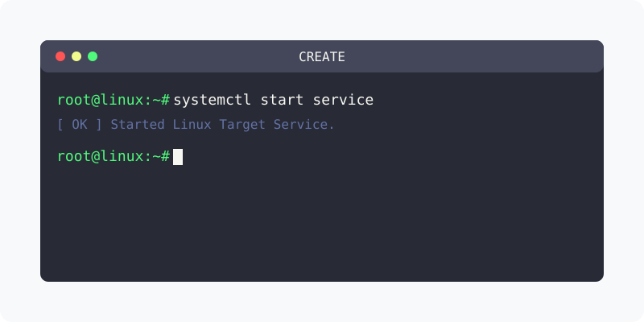

[⬅️ 이전](../) &nbsp;|&nbsp; [🏠 분류 목차](../../../)

방대한 주제를 분할하여 제공합니다.

## 1️⃣ 핵심 학습 가이드
* [머신 생성](part_1/)

  해당 세부 내용에 대한 튜토리얼을 진행합니다.

* [실습 12 VMware로 가상머신 생성하기](part_2/)

  해당 세부 내용에 대한 튜토리얼을 진행합니다.

* [생성된 가상머신 확인하기](part_3/)

  해당 세부 내용에 대한 튜토리얼을 진행합니다.

## 2️⃣ 심화 및 연계 파트 1
* [설치된 파일 확인하기](part_4/)

  해당 세부 내용에 대한 튜토리얼을 진행합니다.

* [가상머신을 목록에서 제거하고 다시 불러오기](part_5/)

  해당 세부 내용에 대한 튜토리얼을 진행합니다.

* [가상머신 부팅하기](part_6/)

  해당 세부 내용에 대한 튜토리얼을 진행합니다.

## 3️⃣ 심화 및 연계 파트 2
* [part_7](part_7/)

  해당 세부 내용에 대한 튜토리얼을 진행합니다.

* [ServerB 가상머신 생성](part_8/)

  해당 세부 내용에 대한 튜토리얼을 진행합니다.

---

[⬅️ 이전](../) &nbsp;|&nbsp; [🏠 분류 목차](../../../)
