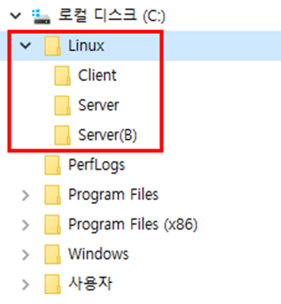
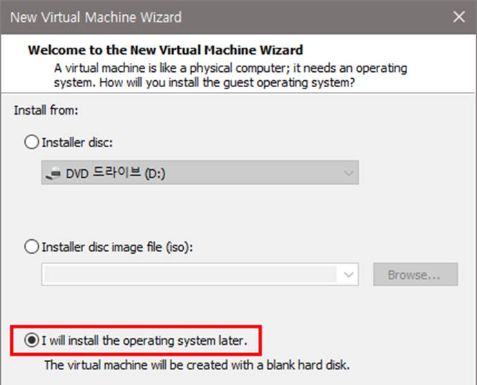
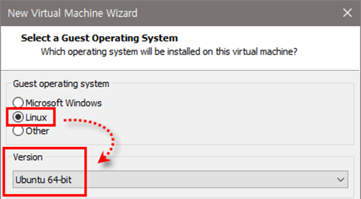
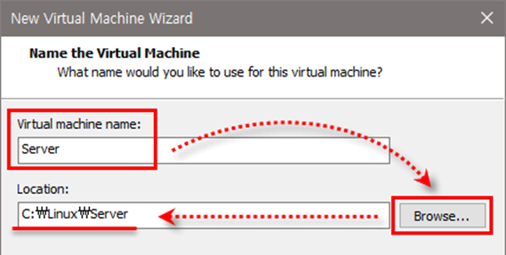
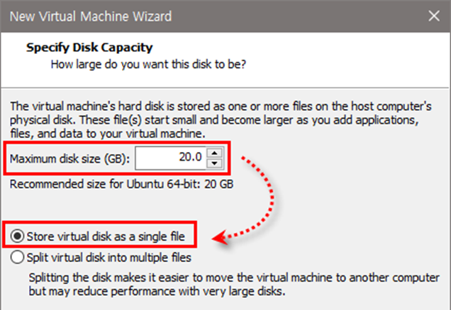
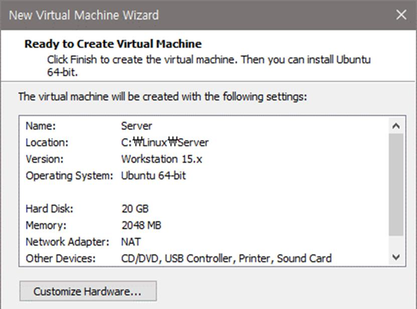

[⬅️ 이전](../) &nbsp;|&nbsp; [🏠 분류 목차](../../../)

# 실습 12 VMware로 가상머신 생성하기

## [실습 1-2] VMware로 가상머신 생성하기

1. Server, Server(B), Client 폴더 생성하기

여유 공간(30GB 이상 권장)이 있는 드라이브에 Linux 폴더 생성, 그 아래에 Server, Server(B), Client 폴더 추가 생성

2. Server 폴더에 가상머신 생성하기

Server를 설치할 가상머신을 C:\Linux\Server 폴더에 생성한 후 작업 표시 줄의 VMware Player 아이콘을 클릭, VMware 실행

가상머신을 새로 만드는 방법 3가지

* VMware 초기 화면에서 왼쪽의 Home 아이콘을 선택한 후, 오른쪽 창의

[Create a New Virtual Machine] 클릭

* VMware 메뉴에서 [Player]-[File]-[New Virtual Machine] 선택

* VMware 초기 화면에서 왼쪽의 Home 아이콘을 선택한 후 마우스 오른쪽 버튼 클릭, [Create a View VM] 선택

[New Virtual Machine Wizard] 창에서 ‘I will install the operating system later.’ 클릭

[Select a Guest Operating System] 창에서 ‘Linux’를 선택한 후

Version 부분의 드롭다운 리스트 중 `Ubuntu 64-bit`를 선택하고 `<Next>` 클릭

[Name the Virtual Machine] 창에서 Virtual machine name에 ‘Server’를 입력한 후

`<Browse>` 클릭,

[폴더 찾아보기] 창이 나타나면 ‘C:\Linux\Server’를 선택하고 <확인> 클릭, Location에 ‘C:\Linux\Server’가 자동 입력되면 <Next> 클릭

디스크 용량은 그대로 두고 ‘Store virtual disk as a single file’을 선택한 후 `<Next>` 클릭

`<Finish>` 클릭, 가상머신 생성 완료

 

---

[⬅️ 이전](../)
