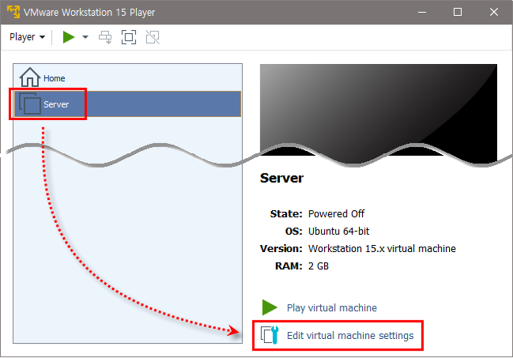
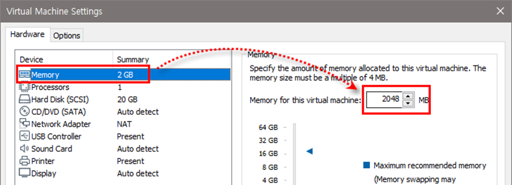
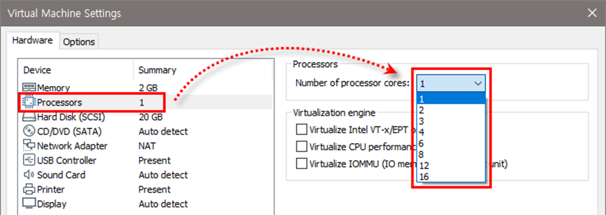
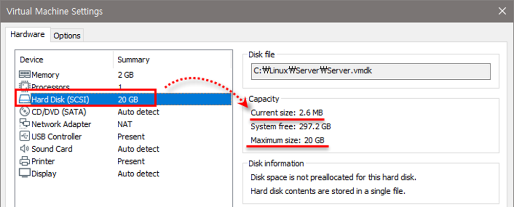
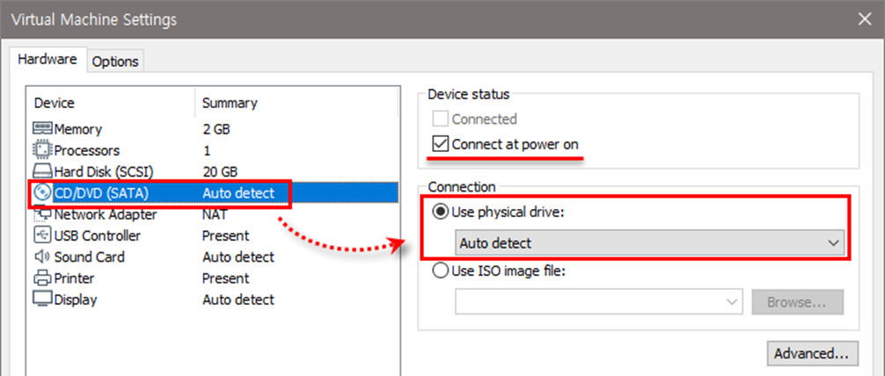
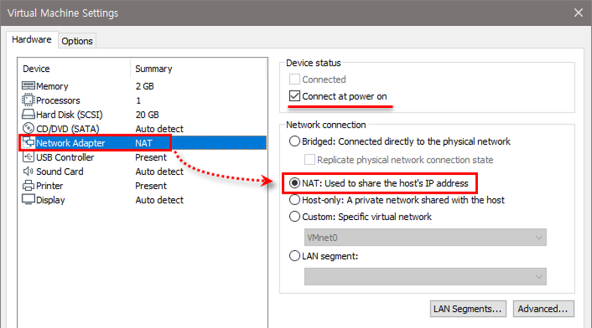
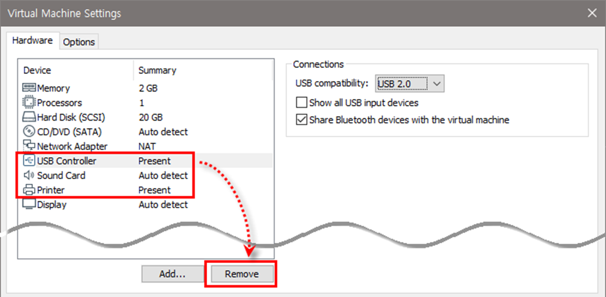
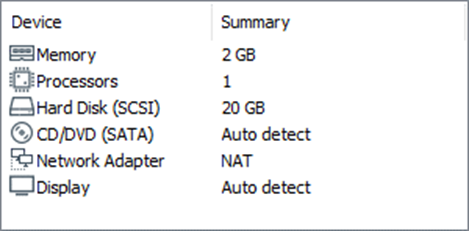

[⬅️ 이전](../) &nbsp;|&nbsp; [🏠 분류 목차](../../../)

# 생성된 가상머신 확인하기

## 생성된 가상머신 확인하기

가상머신에 장착된 부품을 확인하기 위해 [Edit virtual machine settings] 클릭

### 메모리 할당량 변경하기

메모리 할당량을 변경할 수도 있으나 일단은 2048MB 유지

CPU를 여러 개 할당한다고 해도 가상머신의 성능에는 큰 의미가 없으니 1로 유지     

리눅스 실습에는 20GB면 충분, 하드디스크에 아무것도 설치되지 않아 2~3MB만 사용됨

Device status의 ‘Connect at power on’에 체크 표시     

기본 설정인 NAT 방식 사용

USB 컨트롤러, 사운드 카드, 프린터 각각의 장치 선택한 후 <Remove> 클릭, 제거

`<OK>` 클릭, 지금까지 설정한 내용을 확정하고 VMware Player 종료

---

[⬅️ 이전](../)
