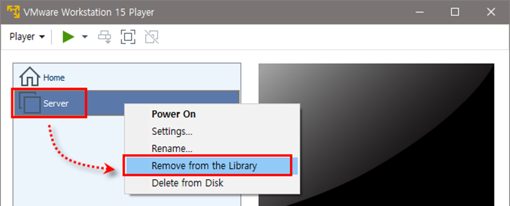
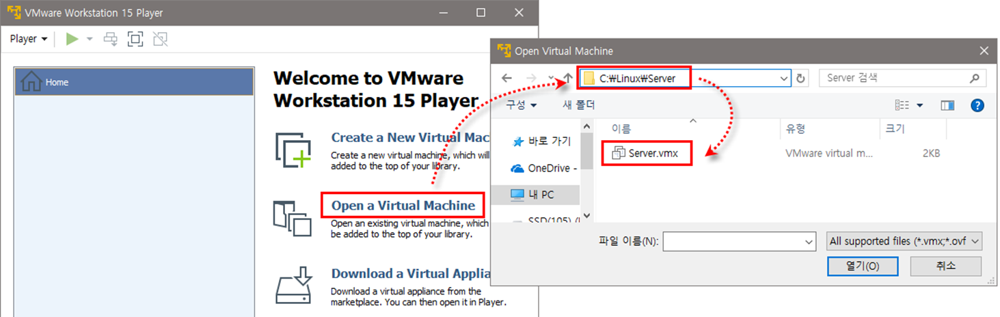

[⬅️ 이전](../) &nbsp;|&nbsp; [🏠 분류 목차](../../../)

# 가상머신을 목록에서 제거하고 다시 불러오기

## 가상머신을 목록에서 제거하고 다시 불러오기

VMware Player 실행  
Server를 선택한 후 마우스 오른쪽 버튼을 클릭하여 `Remove from the Library` 선택

가상머신을 목록에 다시 추가하려면 오른쪽 창의 [Open a Virtual Machine] 클릭,
`C:\Linux\Server\Server.vmx`를 열거나 메뉴에서 [Player]-[File]-[Open] 선택

---

[⬅️ 이전](../)
