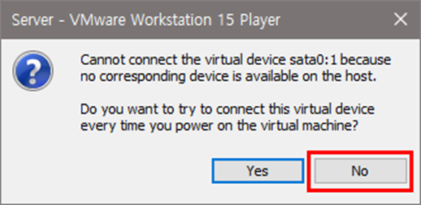
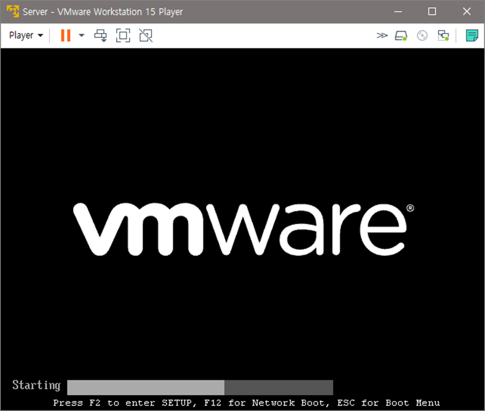
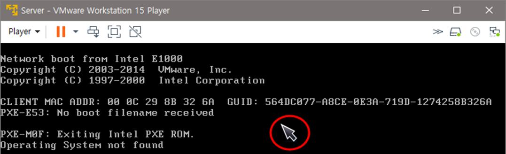
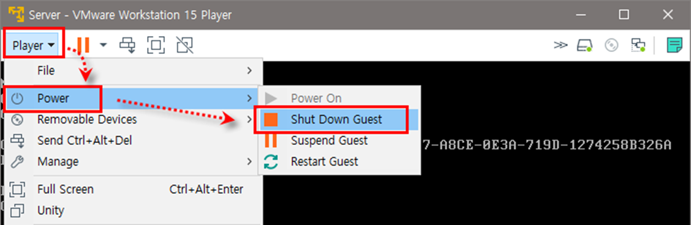

[⬅️ 이전](../) &nbsp;|&nbsp; [🏠 분류 목차](../../../)

# 가상머신 부팅하기

## 가상머신 부팅하기

가상머신을 켜는 방법 4가지

* 오른쪽 창에서 Play virtual machine 아이콘 클릭

* 메뉴에서 [Player]-[Power]-[Power On] 선택

* 마우스 오른쪽 버튼을 클릭하여 ‘Power On’ 선택

* 메뉴 중 초록색 아이콘(▶) 클릭

부팅할 때 다음과 같은 메시지가 나오면 <No> 클릭

잠시 기다리면 가상머신 가동

부팅 과정에서 `Operating System not found` 라는 메시지가 나옴과 동시에 마우스 포인터가 움직이지 않을 것, Ctrl + Alt 를 눌렀다 떼면 마우스 포인터가 보임

[Player]-[Power]-[Shut Down Guest] 선택, 가상머신의 전원을 끔 경고 메시지가 나오면 <Yes> 클릭

VMware 실행, 왼쪽의 Home 아이콘 클릭 후 오른쪽 창의 [Create a New Virtual Machin] 클릭

---

[⬅️ 이전](../)
