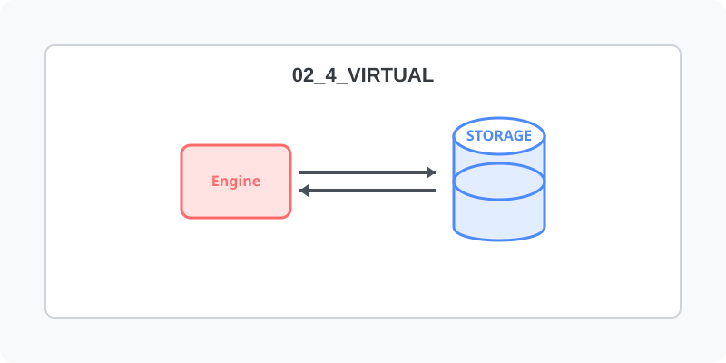

[⬅️ 이전: 2.3 로키(Rocky) 리눅스 세팅](../02_3_rocky/) &nbsp;|&nbsp; [🏠 분류 목차](../../) &nbsp;|&nbsp; [다음: VirtualBox ➡️](02_4_1_virtualbox/)

개별 호스트 PC 내에서 물리 하드웨어 종속을 탈피해 제한된 독립 가상 구역을 생성하는 하이퍼바이저 기반 가상머신 기술을 이해하고 환경을 구축합니다.

## 1️⃣ 가상화 아키텍처 이해
배어메탈 방식과 가상화 방식의 차이를 비교하고 기술 스택을 알아봅니다.

* [리눅스 가상화의 구조 및 도구 선택 가이드](02_4_0_concept/)

  PC 1대에서 다수의 운영체제를 병렬 구동하게 해주는 하이퍼바이저의 원리를 깨우치고, 실습 시 주로 사용될 VirtualBox, VMWare, 그리고 초경량 WSL 플랫폼의 특장점을 비교 분석하여 최적화된 학습 인프라 구축 방향을 수립합니다.

 

## 2️⃣ 가상머신 플랫폼 실무 세팅
선택한 하이퍼바이저 플랫폼 도구를 윈도우/맥OS 로컬 데스크탑 환경에 직접 장착하고 셋업합니다.

* [Oracle VirtualBox (버추얼박스) 구축 실습](02_4_1_virtualbox/)

  현업과 교육망에서 가장 널리 쓰이는 대중적인 완전 무료 하이퍼바이저인 버추얼박스를 윈도우 환경에 설치하고, 첫 번째 리눅스를 부팅시킬 시스템 자원(램, 디스크)을 할당받는 패러다임을 익힙니다.

* [VMWare (브이엠웨어) 장착 프로세스](02_4_2_vmware/)

  기업 시장 및 워크스테이션에서 압도적으로 채택되는 상업용 가상화 소프트웨어 VMWare를 이용해 조금 더 고도화된 설정 및 유동적인 네트워크 브릿지 환경을 배정해보는 과정을 학습합니다.

[⬅️ 이전: 2.3 로키(Rocky) 리눅스 세팅](../02_3_rocky/) &nbsp;|&nbsp; [🏠 분류 목차](../../) &nbsp;|&nbsp; [다음: VirtualBox ➡️](02_4_1_virtualbox/)
