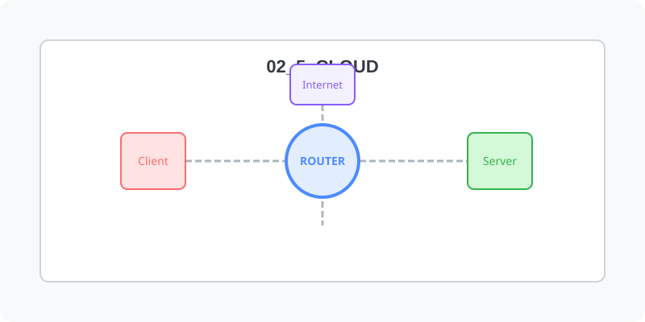

[⬅️ 이전: VMWare 17 설치](../02_4_virtual/02_4_2_vmware/vm17/) &nbsp;|&nbsp; [🏠 분류 목차](../../) &nbsp;|&nbsp; [다음: AWS 클라우드 ➡️](02_5_1_aws/)

물리적인 하드웨어 장비 없이 온라인 상의 거대한 자원풀에서 컴퓨팅 파워를 빌려 쓰는 클라우드 컴퓨팅 환경의 리눅스 활용법을 학습합니다.

로컬 환경의 한계를 돌파하는 클라우드 아키텍처망을 이해합니다.

## 1️⃣ 핵심 학습 가이드
* [리눅스 클라우드 서비스의 이해](02_5_0_concept/)

  IaaS, PaaS, SaaS의 개념과 트래픽에 맞춰 인터넷망을 통해 탄력적으로 가상 서버 자원을 스케일링하는 클라우드 컴퓨팅 기반 리눅스 운영의 핵심 장점을 익힙니다.

 

* [AWS (아마존 웹 서비스) 환경 셋업](02_5_1_aws/)

  압도적인 글로벌 점유율 1위 플랫폼인 AWS의 가입 과정과 EC2 인스턴스를 통해 첫 번째 클라우드 리눅스 머신을 생성하여 SSH로 원격 접속하는 방법을 배웁니다.

## 2️⃣ 심화 및 연계 파트 1
* [Azure (마이크로소프트) 클라우드 환경 셋업](02_5_2_azure/)

  엔터프라이즈 환경에서 윈도우 인프라(Active Directory 등)와 강력하게 결합되는 MS Azure 환경에서의 리눅스 운영 및 배포법을 실습합니다.

* [Naver Cloud (네이버 클라우드) 실무](02_5_4_naver/)

  국내 인프라 환경에서 빠르고 친숙하게 접근할 수 있는 B2B 특화 플랫폼, 네이버 클라우드 플랫폼(NCP)의 리눅스 머신 생성 프로세스를 다룹니다.

## 2️⃣ 퍼블릭 벤더(Vendor) 인스턴스 구축
세계 시장을 리드하는 주요 클라우드 프로바이더들의 퍼블릭망에서 인스턴스를 직접 대여합니다.

---

[⬅️ 이전: VMWare 17 설치](../02_4_virtual/02_4_2_vmware/vm17/) &nbsp;|&nbsp; [🏠 분류 목차](../../) &nbsp;|&nbsp; [다음: AWS 클라우드 ➡️](02_5_1_aws/)
