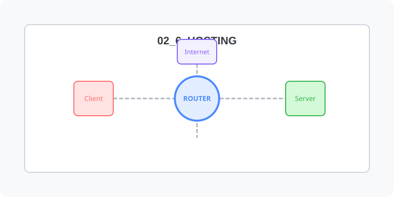

[⬅️ 이전: 클라우드 가상화](../02_5_cloud/02_5_5_virtual/) &nbsp;|&nbsp; [🏠 분류 목차](../../) &nbsp;|&nbsp; [다음: 서버 호스팅 ➡️](02_6_1_server/)

클라우드처럼 가상 인스턴스를 빌리는 것이 아니라, 이미 운영체제가 셋업된 외부의 실제 서비스 공간(또는 물리 서버)을 대여받아 통제하는 전통적인 호스팅 접근 방식에 대해 다룹니다.

## 1️⃣ 호스팅 네트워크의 이해
서비스를 제공할 인터넷 공간을 외주 데이터센터로부터 할당받는 호스팅의 개념을 익힙니다.

* [호스팅 서비스의 종류와 기본 이해](02_6_0_concept/)

  한 대의 대형 머신을 수십 명이 나누어 쓰는 저렴한 공유형 웹 호스팅과, 서버 시스템 한 대를 통째로 임대하는 독립 서버 호스팅 생태계의 차이점을 파악합니다.

 

## 2️⃣ 호스팅 제어권 실무 확보
실제 호스팅 서비스를 신청하고 터미널을 통해 원거리 서버를 제어하는 방식입니다.

* [공유형 웹 호스팅 환경 셋업](02_6_2_web/)

  주로 FTP나 파일 매니저, 웹 서버 단의 권한만을 제한적으로 통제하여 빠르게 애플리케이션을 배포하는 공유 호스팅 세팅 실습을 진행합니다.

* [독립 머신 서버 호스팅 프로세스](02_6_1_server/)

  서버 하드웨어를 전부 독점하여 리눅스의 전지전능한 최고 관리자(Root) 권한을 직접 쥐고 운영체제 전체를 통제하는 본격적인 데이터센터 서버망 셋업 실습을 다룹니다.

---

[⬅️ 이전: 클라우드 가상화](../02_5_cloud/02_5_5_virtual/) &nbsp;|&nbsp; [🏠 분류 목차](../../) &nbsp;|&nbsp; [다음: 서버 호스팅 ➡️](02_6_1_server/)
