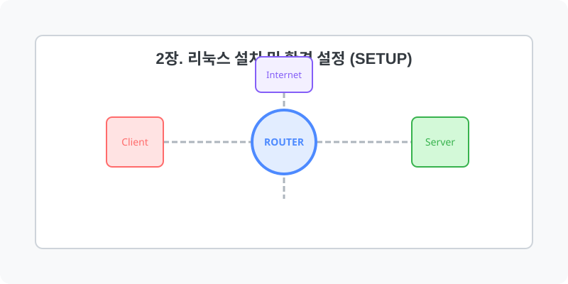

[⬅️ 이전: 설정](../01_prologue/01_3_xwindow/01_3_1_setting/) &nbsp;|&nbsp; [🏠 분류 목차](../) &nbsp;|&nbsp; [다음: 2.1 설치 준비 (ISO 및 인스톨러) ➡️](02_1_prepare/)

# 2장. 리눅스 설치 및 환경 설정 (Setup)

리눅스를 실무 환경에서 활용하기 위한 첫 단계로, 다양한 방식의 리눅스 설치 방법과 인프라 운영 환경 세팅을 학습합니다. 가상머신(Hypervisor), 서버 클라우드, 일반 베어메탈 물리 서버 등 인프라의 형태별 구축 방식을 파악해보세요.

직접 하드웨어 환경을 구축하거나 OS 인스톨러를 다루는 로컬 기반의 구성 요소를 다룹니다.

## 1️⃣ 핵심 학습 가이드
* [설치 준비 (ISO 및 인스톨러)](02_1_prepare/)

  성공적인 시스템 마이그레이션과 설치를 위해 반드시 알아야 할 ISO 이미지 파일의 구조 및 작동 방식과 각 OS별 인스톨러의 개념을 짚고 넘어갑니다.

* [데스크톱용 Ubuntu 구축](02_2_ubuntu/)

  접근성이 좋고 커뮤니티 지원이 많은 데비안 계열의 핵심 배포판, 우분투(Ubuntu) 리눅스의 인스톨러 사용 과정과 초기 데스크톱 구성 및 패키지 관리 기본을 실습합니다.

* [서버용 Rocky Linux 구축](02_3_rocky/)

  RHEL 환경을 100% 호환하는 차세대 서버용 운영체제인 Rocky Linux의 탄생 배경과 터미널 및 인스톨 시스템(Anaconda)의 통제 과정을 경험합니다.

 

## 2️⃣ 심화 및 연계 파트 1
* [가상화 시스템 환경 (Virtualization)](02_4_virtual/)

  VirtualBox 등의 하이퍼바이저를 사용하여 내 호스트 PC 시스템을 논리적으로 분할하고, 여러 대의 리눅스를 안전하고 독립적으로 구동하는 가상화 기술을 다룹니다.

* [클라우드 인스턴스 서버 (Cloud)](02_5_cloud/)

  물리 장비의 제약 없이, 클릭 몇 번으로 즉각 서버를 임대 받아 원격 제어하는 AWS, Azure, Naver 클라우드 컴퓨팅 기반 환경을 실습합니다.

* [호스팅 서비스 연동 (Hosting)](02_6_hosting/)

  웹 호스팅, 서버 호스팅 등의 방식으로 원격지에 구축된 외부 리눅스 서버망을 대여받아 패키지를 운영하는 전통적인 네트워크 접근 방식을 익힙니다.

## 2️⃣ 가상화 및 클라우드 원격 환경
단일 PC의 한계를 넘어 가상 머신(VM) 하이퍼바이저와 외부 클라우드 망을 통해 시스템을 운용합니다.

> **💡 핵심 사항:**
> 기존 윈도우 환경 사용자들을 위한 가장 접근성 높은 구성 방법인 `WSL(Windows Subsystem for Linux)`에 대해서도 살펴보며 자신에게 맞는 최적의 구축 방향을 찾아보세요!

---

[⬅️ 이전: 설정](../01_prologue/01_3_xwindow/01_3_1_setting/) &nbsp;|&nbsp; [🏠 분류 목차](../) &nbsp;|&nbsp; [다음: 2.1 설치 준비 (ISO 및 인스톨러) ➡️](02_1_prepare/)
