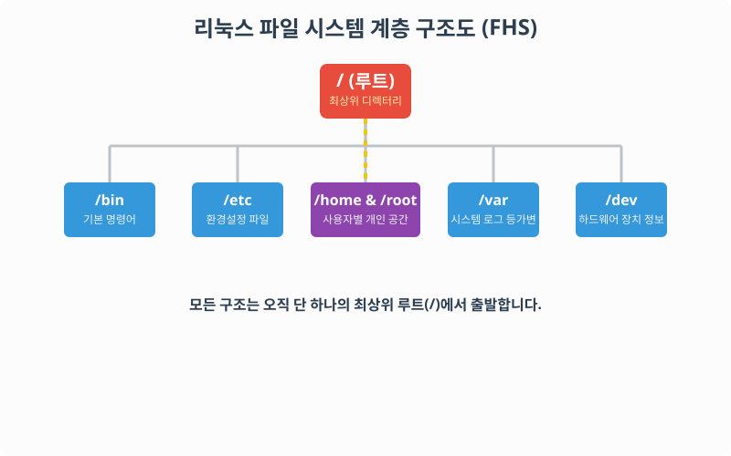
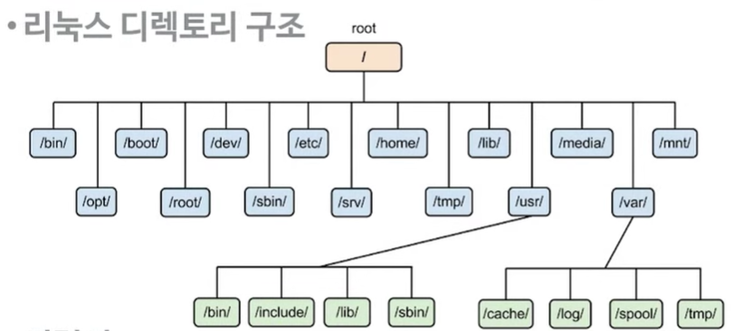

# 3.1 파일 시스템 구조와 기능 이해

운영체제의 역할 중 가장 중요한 것은 하드 디스크에 데이터를 어떻게 저장하고 관리할 것인가, 즉 **파일 시스템(File System)** 을 설계하고 통제하는 것입니다. 윈도우는 `C:\`, `D:\` 처럼 드라이브별로 파일 시스템을 나누지만, 리눅스는 전혀 다른 방식으로 파일 시스템을 시각화합니다.

> **동작 원리**: 리눅스의 디렉터리 구조는 거꾸로 서 있는 나무(Tree) 모양을 닮았습니다. 가장 위에는 무조건 1개의 `/(루트)` 디렉터리가 존재하며, 거기서부터 모든 하위 폴더들이 체계적으로 가지를 쳐 내려갑니다.

---

## 1. 파일 시스템이란?

운영체제의 파일 시스템은 디렉토리 구조, 파일 이름 규칙, 접근 권한 등을 결정하여 데이터를 안전하게 관리하는 체계입니다. 데이터 블록(실제 내용)과 인덱스 블록(위치 정보)을 사용하여 자원을 관리합니다.

### 1.1 리눅스 파일 시스템의 핵심 특징
1. **계층적인 디렉토리 구조**: 최상위 루트(`/`)에서 시작하여 하위 디렉토리를 계속해서 생성합니다. (FHS: Filesystem Hierarchy Standard)
2. **모든 것은 파일이다**: 파일뿐만 아니라, 연결된 키보드(하드웨어), 실행 중인 프로세스, 모니터 등 윈도우에서는 장치로 인식하는 것들마저 리눅스에서는 하나의 '파일'로 취급합니다.
3. **엄격한 대소문자 구분**: `a.txt`와 `A.txt`는 서로 완전히 다른 별개의 파일입니다.
4. **다양한 파일 시스템 포맷 지원**: `ext3`, `ext4`, `XFS` 등 고성능 포맷을 범용적으로 지원하며 심지어 윈도우용 `NTFS`도 마운트하여 사용할 수 있습니다.

---

## 2. 리눅스의 표준 디렉토리 종류 (FHS)

리눅스를 설치하면 운영체제가 시스템을 원활히 굴리기 위해 미리 약속된 이름의 디렉터리들을 만들어 둡니다.

> 기존에 첨부하신 시스템 관리 구조 이미지입니다.
> 

### 2.1 관리 및 설정용 디렉터리
- **`/` (루트)** : 윈도우의 `내 PC` 에 해당하는 최상위 지점입니다. 절대 지워져서는 안 됩니다.
- **`/etc`** : 윈도우의 '제어판'이나 '레지스트리' 역할을 하는 곳입니다. 리눅스의 전역 환경 설정 파일들이 모여 있습니다.
- **`/boot`** : 리눅스 부팅에 필수적인 커널(.img 파일 등)과 시작 찌꺼기 파일이 저장됩니다.

### 2.2 명령어 유틸리티 디렉터리
- **`/bin`** : 기본적으로 누구나 쓸 수 있는 표준 유닉스 명령어(ls, mv, cp 등) 실행 파일들이 담겨 있습니다.
- **`/sbin`** : 루트 관리자 전용 명령어(시스템 종료, 네트워크 재시작 등)가 저장된 곳입니다.

### 2.3 사용자 전용 구역 공간
- **`/home`** : 윈도우의 `C:\Users\` 와 같습니다. 각 사용자 별로 개인 폴더가 할당되며 그 안에서 자유롭게 파일을 수정할 수 있습니다.
- **`/root`** : 최고 권한 관리자이자 슈퍼유저인 `root` 계정만의 절대 성역이자 홈 디렉터리입니다. (`/` 와는 다릅니다!)

### 2.4 가상 장치 및 로그 디렉터리
- **`/dev`** : 컴퓨터에 장착된 모니터, 하드디스크, 키보드 등의 모든 하드웨어 장치를 '파일 형태'로 가상화시켜 보관하는 시스템 공간입니다.
- **`/var`** : 프로그램이 활동하면서 시스템에 남기는 흔적이나 에러 모음인 **로그(Log)** 데이터들이 실시간으로 기록되는 가변 확장 공간입니다.
