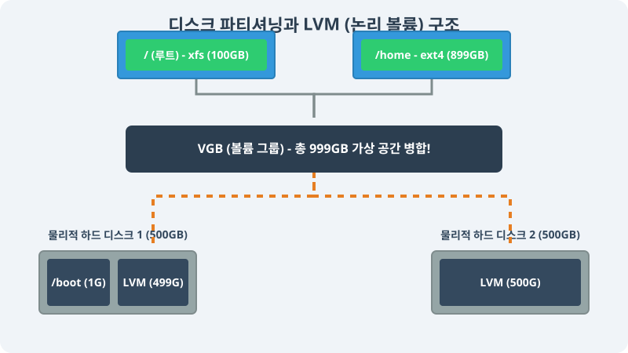

# 3.2 리눅스 디스크 시스템 개요

리눅스는 파일 시스템(File System)을 사용하여 디스크를 관리합니다. 파일 시스템은 디스크에 저장된 파일의 인덱스와 디렉터리 경로를 관리하며, 파일 시스템이 마운트되어 있지 않으면 디스크의 빈 공간을 사용하는 것이 불가능합니다.

> **동작 원리**: 물리적인 하드 디스크 여러 개를 파티션(Partition)으로 조각낸 뒤, LVM(Logical Volume Manager) 기술을 이용해 가상의 거대한 한 덩어리로 묶고, 이를 다시 원하는 크기의 논리 볼륨(Logical Volume)으로 유연하게 나눠 사용합니다.

---

## 1. 리눅스 파일 시스템의 종류

리눅스에서는 시대의 발전에 따라 여러 종류의 파일 시스템 포맷을 지원합니다. 각 파일 시스템은 디스크 공간을 나누고, 파일을 저장하며, 장애 발생 시 파일을 탐색하고 복구하는 알고리즘이 서로 다릅니다.

- **ext2, ext3, ext4**: 오랫동안 데비안/우분투 계열에서 표준으로 사용되어 온 안정적인 리눅스 전통 포맷입니다. (현재는 저널링 복원 기능이 강화된 ext4가 가장 많이 쓰임)
- **XFS**: CentOS, 로키 리눅스 등 레드햇 계열에서 기본값으로 채택된 대용량 데이터 처리용 고성능 포맷입니다.
- **Btrfs**: 차세대 파일 시스템으로, 자체적인 스냅샷(백업) 압축 기능을 제공합니다.

---

## 2. 디스크 파티션 (Partition)

리눅스에서는 거대한 디스크 공간을 **파티션(Partition)** 이라는 독립된 작은 블록으로 나눕니다.

### 2.1 파티션 분리의 특징
- 각 파티션은 별도의 독립적인 파일 시스템(포맷)을 가질 수 있습니다.
- 예를 들어, 1번 파티션은 윈도우용 `NTFS`로 포맷하고, 2번 파티션은 리눅스용 `ext4`로 포맷하여 하나의 디스크 안에 두 OS를 공존시킬 수 있습니다.
- 시스템 부팅 파티션(`/boot`)과 사용자 파티션(`/home`)을 물리적으로 나눔으로써 하나의 파티션이 꽉 차도 시스템 전체가 마비되는 것을 막습니다.

---

## 3. 논리적 공간 병합 제어 (LVM)

서버를 운영하다 보면 `/home` 디스크가 꽉 차서 용량을 늘려야 하는 순간이 반드시 옵니다. 하지만 물리적인 하드 디스크 하나가 감당할 수 있는 용량에는 한계가 있습니다. 이를 극복하는 것이 **LVM(Logical Volume Manager)** 기술입니다.

### 3.1 LVM의 장점
- **무한한 확장성**: 500GB 하드 디스크 2개를 꽂은 뒤 LVM으로 묶으면 시스템은 이를 1000GB짜리 거대한 단일 하드 디스크로 인식합니다.
- **유연한 용량 조절**: 서버를 끄지 않고도 남는 공간을 데이터베이스 파티션에 실시간으로 갖다 붙여 사이즈를 늘릴 수 있어 다운타임이 발생하지 않습니다.
