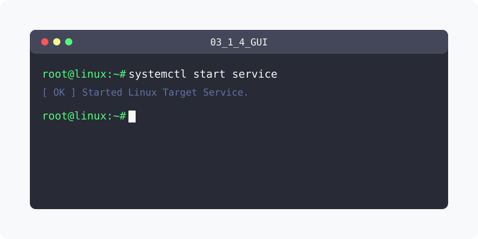

[⬅️ 이전: 그룹관리 명령어](../03_1_3_command/) &nbsp;|&nbsp; [🏠 분류 목차](../../../) &nbsp;|&nbsp; [다음: 리눅스 시스템의 사용자 목록 ➡️](../03_1_5_list/)

# X-Window에서 로그아웃 하는 방법
데스크톱 환경에서는 주로 우측 상단의 로그아웃 버튼을 클릭하거나, 시스템 메뉴에서 로그아웃을 선택하여 로그아웃합니다.

## X-윈도우에서 로그아웃
바탕화면 오른쪽 위 ▼ 아이콘, [root], <로그아웃>을 이어서 클릭

<!-- Broken Image Removed: ../img/image-20230322172231680.png -->

## 단축키 사용
일부 데스크톱 환경에서는 `Ctrl + Alt + Delete` 등의 단축키를 사용하여 `로그아웃`할 수 있습니다.

---

[⬅️ 이전: 그룹관리 명령어](../03_1_3_command/) &nbsp;|&nbsp; [🏠 분류 목차](../../../) &nbsp;|&nbsp; [다음: 리눅스 시스템의 사용자 목록 ➡️](../03_1_5_list/)
