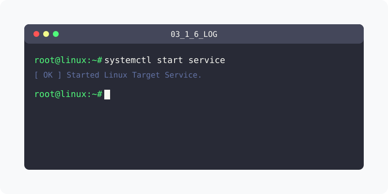

[⬅️ 이전](../) &nbsp;|&nbsp; [🏠 분류 목차](../../../)

# 로그인 기록
리눅스는 접속을 하는 모든 사용자의 로그인을 기록합니다.

## 1️⃣ 세부 학습 가이드
방대한 주제를 분할하여 제공합니다.

* [로그인 기록](part_1/)

  해당 세부 내용에 대한 튜토리얼을 진행합니다.

* [접속기록](part_2/)

  해당 세부 내용에 대한 튜토리얼을 진행합니다.

---

[⬅️ 이전](../) &nbsp;|&nbsp; [🏠 분류 목차](../../../)
