[⬅️ 이전: 사용자 비밀번호](../03_1_7_password/) &nbsp;|&nbsp; [🏠 분류 목차](../../../) &nbsp;|&nbsp; [다음: 권환 획득 ➡️](../03_1_9_su/)

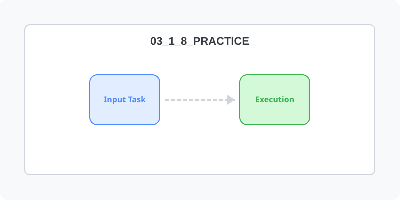

# 사용자 및 그룹생성 실습

## 실습

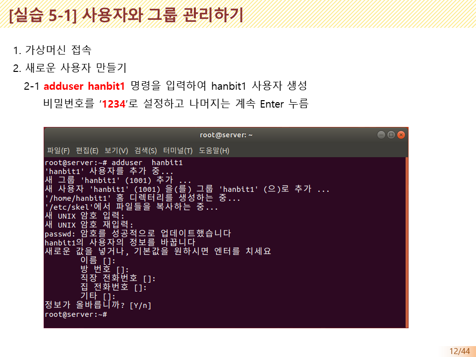

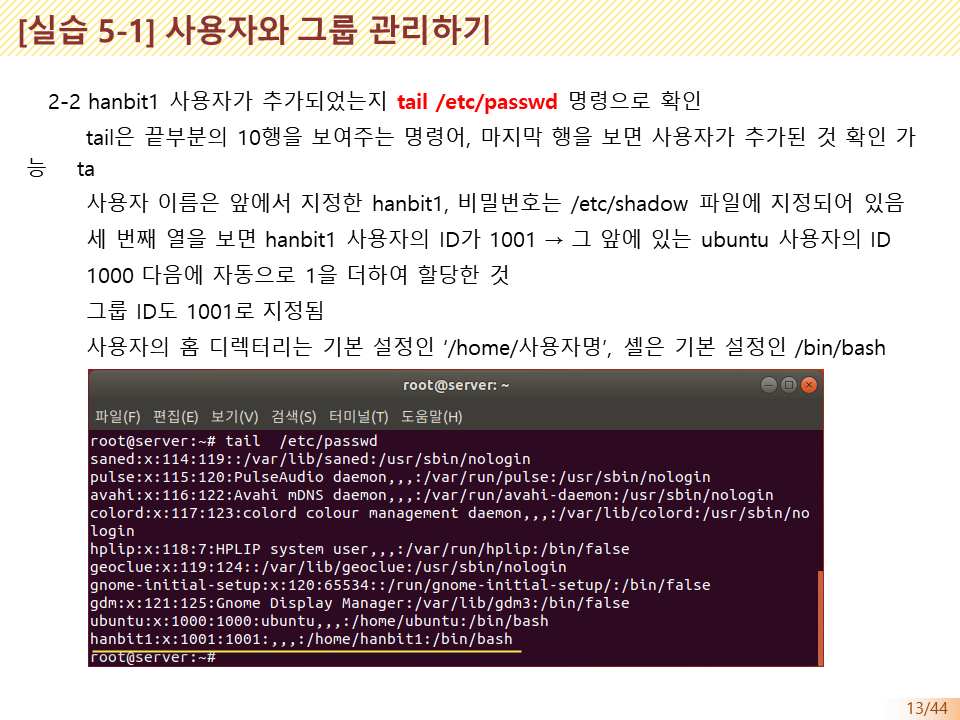

<!-- Broken Image Removed: ../img/슬라이드14.PNG -->

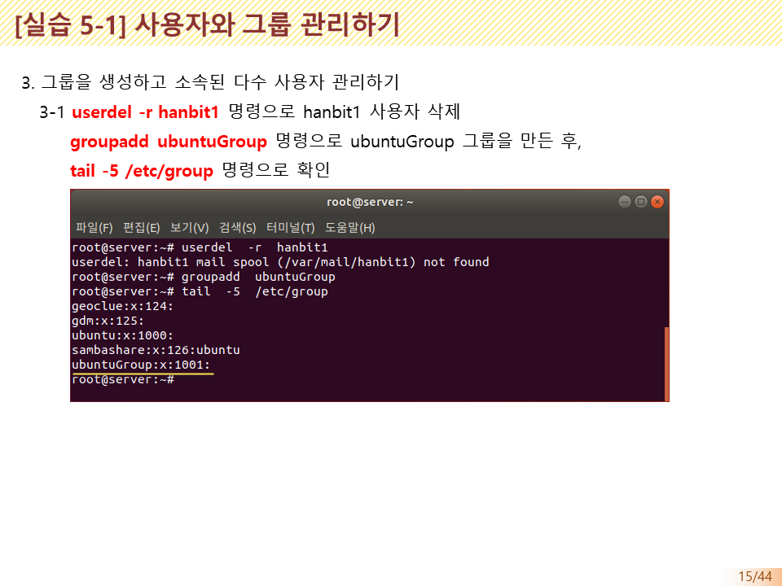

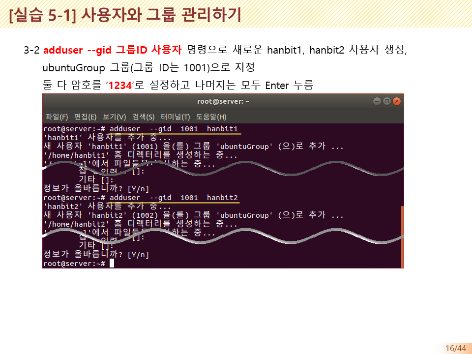

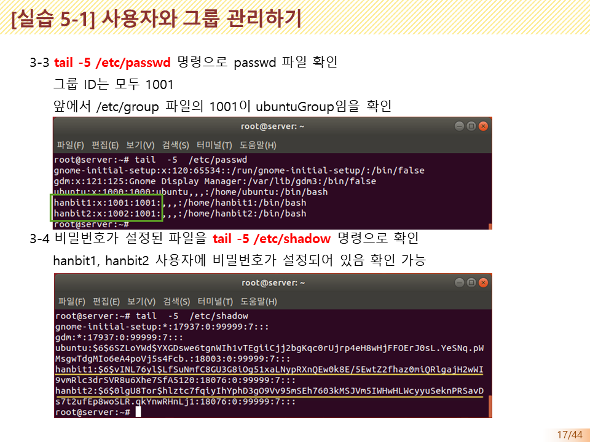

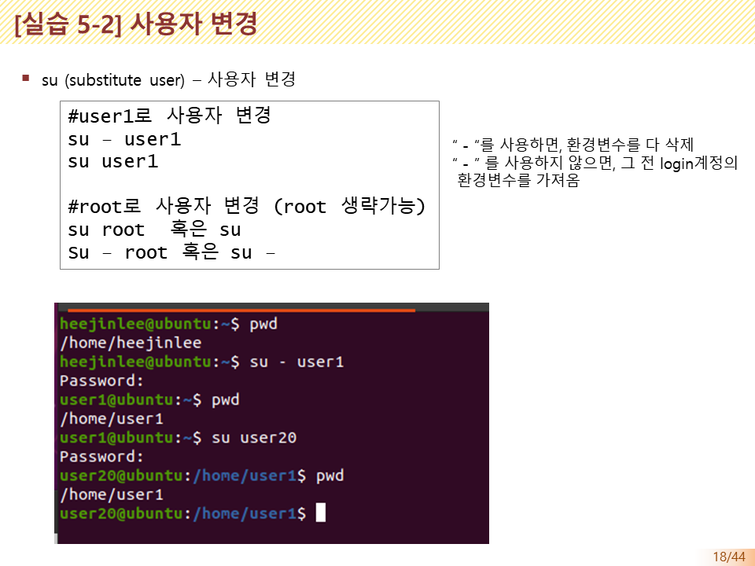

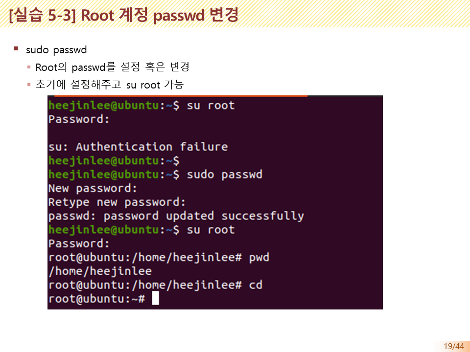

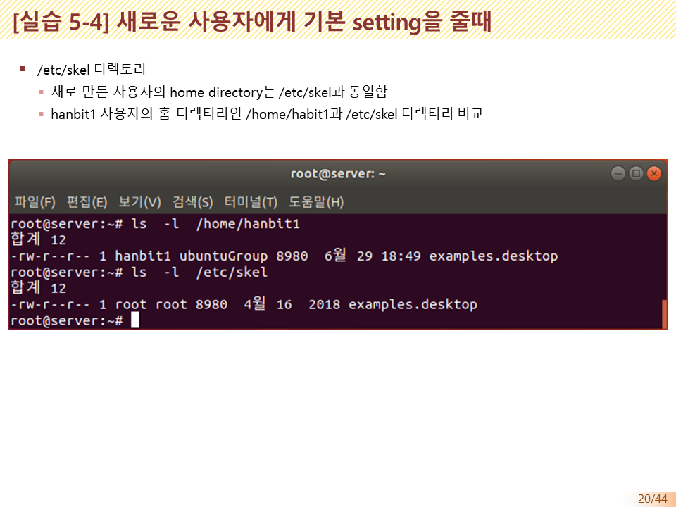

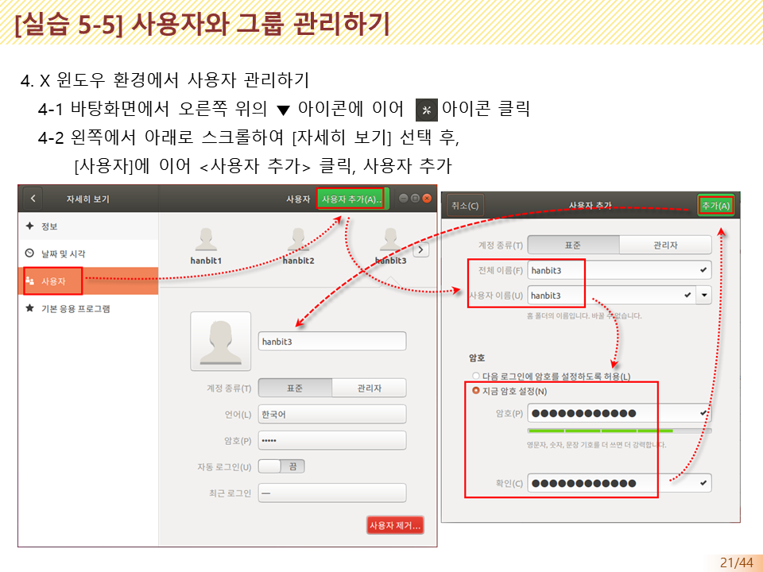

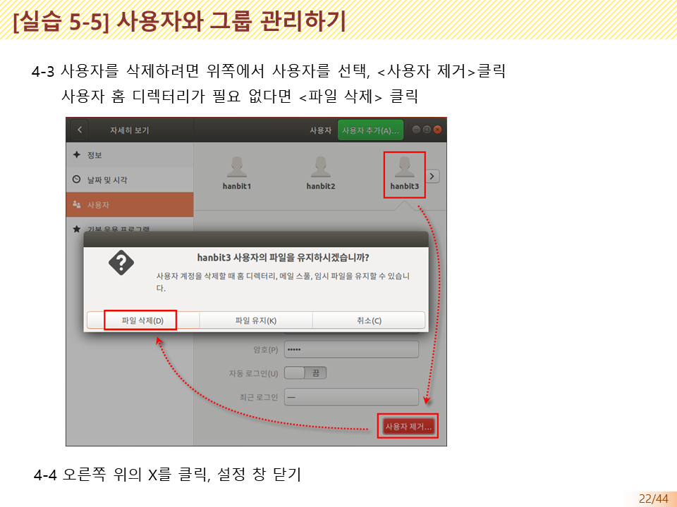

---

[⬅️ 이전: 사용자 비밀번호](../03_1_7_password/) &nbsp;|&nbsp; [🏠 분류 목차](../../../) &nbsp;|&nbsp; [다음: 권환 획득 ➡️](../03_1_9_su/)
