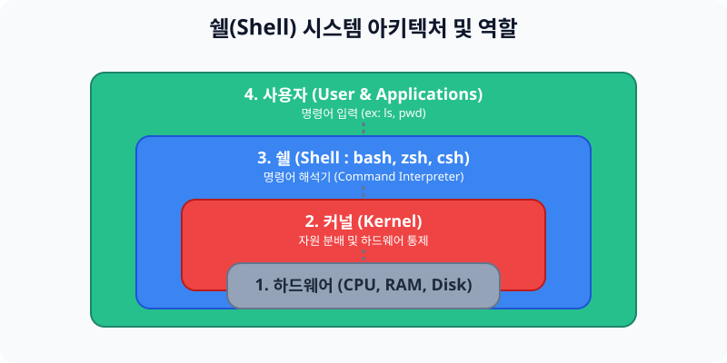

# 5.1 쉘(Shell) 시스템의 이해

리눅스 커맨드(명령어)를 이용하면 시스템 내부에서 다양하고 강력한 일들을 할 수 있습니다. 
하지만 단순한 명령어 입력을 넘어, 반복적이고 복잡한 일들을 운영체제가 스스로 처리할 수 있도록 제어하려면 먼저 **쉘(Shell)** 의 역할을 명확히 이해해야 합니다.


> **동작 원리**: 사용자가 키보드로 `ls` 등 인간의 언어(명령어)를 입력하면 껍데기인 **쉘(Shell)** 이 이를 받아들여 기계어(이진수)로 번역한 후 심장인 커널(Kernel)에게 전달합니다.

---

## 1. 쉘(Shell) 이란?

쉘은 하드웨어와 사용자 사이에 위치하는 일종의 **명령어 번역기(Command Interpreter)** 프로그램입니다. 커널이 견과류의 알맹이라면, 쉘은 그 알맹이를 둘러싼 껍데기에 해당합니다.

### 1.1 쉘의 역할
* 사용자가 입력한 명령을 해석하여 운영체제가 이해할 수 있게 넘깁니다.
* 스크립트(Script) 기능: 매번 일일이 커맨드 라인을 한 줄씩 치는 부담을 덜기 위해, 여러 명령들의 집합파일을 작성하여 한 번에 수행(자동화)시킬 수 있습니다.

### 1.2 쉘의 주요 종류
유닉스/리눅스의 긴 역사만큼 쉘도 다양하게 파생되었습니다.
1. **Bourne Shell (sh)**: 최초의 유닉스 쉘.
2. **Bash (Bourne-Again Shell)**: 현재 우분투, 로키 등 대부분의 표준 리눅스에서 기본(Default)으로 쓰이는 가장 대표적인 쉘입니다.
3. **Zsh**: 최근 macOS에서 기본 환경으로 채택된 쉘로, 자동완성이나 플러그인 기능이 가장 뛰어납니다.

---

## 2. 쉘 스크립트 개요

쉘 스크립트 프로그래밍을 학습하면 아래와 같은 Bash 쉘의 핵심 기능들을 자유자재로 제어할 수 있습니다.

* **변수 관리**: [변수란?](var) / [환경변수](var) / [단위 및 범위 지정 (Scope)](scope)
* **주요 기능 제어**: [Quoting Rule](rules) / 다중 커맨드(Nesting) / [가명 지정 (Alias)](rules) / 프롬프트(Prompt)
* **파일 흐름 제어**: [입출력 리다이렉션 (Redirection)](rules) / [명령어 연결 파이프라인 (Pipeline)](rules)
* **알고리즘 구성**: 외부 입력(echo/read), 수식계산, [제어문(if/case)](if), [반복문(loop)](loop)

---

## 3. [실습] 내 작업 환경의 쉘 확인하기

이론으로 배운 쉘이 내 컴퓨터 환경에서 어떻게 등록되어 있는지 직접 터미널 창을 열고 확인해 보는 실습입니다.

### 실습 1. 접속 중인 기본 쉘 확인
터미널을 열고, 현재 환경변수에 등록된 기본 쉘의 종류를 확인합니다.
```bash
# $SHELL 은 현재 로그인한 사용자의 기본 쉘을 나타내는 환경변수입니다.
echo $SHELL
```
*(결과 예시: `/bin/bash` 또는 `/bin/zsh`)*

### 실습 2. 시스템에서 사용 가능한 모든 쉘 목록 조회
현재 리눅스 서버에 설치되어 있는 모든 종류의 쉘 경로를 확인해 봅니다.
```bash
# /etc/shells 설정의 내용을 문자 그대로 출력합니다.
cat /etc/shells
```
*(결과 예시: `/bin/sh`, `/bin/bash`, `/usr/bin/zsh` 등 리스트 출력)*
