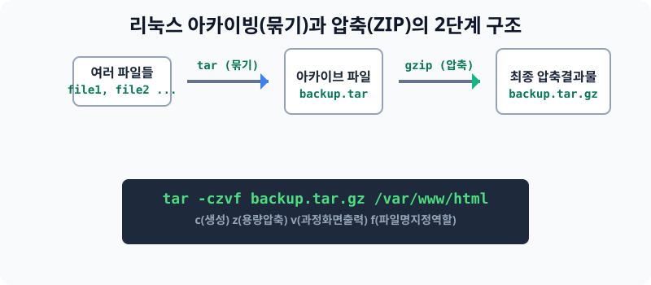

# 14.1 유지보수 백업의 핵심, 아카이빙 (tar) 구조

해커의 공격을 받아 웹 사이트 코드가 날아가거나 디스크가 고장 나서 데이터베이스 정보가 증발했을 때, 복구하기 위해 미리 데이터를 안전한 곳에 **'압축 포장'** 해 놓는 작업을 백업(Backup)이라고 합니다. 리눅스에서는 이 포장 작업의 표준으로 펭귄 세계의 집타이(Zip-tie)라 불리는 `tar`를 활용합니다.


> **동작 원리**: 윈도우 환경에서는 우클릭을 누르고 '.zip'을 누르면 묶기와 압축이 한 번에 됩니다. 반면 전통적인 유닉스(리눅스)는 설계 사상에 따라 **1단계: 여러 파일을 하나로 묶기(Archive = tar)** 와 **2단계: 합쳐진 용량을 줄이기(Compress = gzip)** 두 가지 단계가 철저하게 분리되어 있습니다.

---

## 1. 아카이빙(tar) 및 압축(gzip) 방식

파일들을 백업할 때 실무에서 가장 많이 치게 될 마법의 4글자 `czvf` 와 `xzvf` 를 무조건 기억해야 합니다.

### 1-1. 데이터를 백업(압축) 할 때 (`c`reate)
* 명령어 포맷: `tar -czvf [만들압축파일명] [원본타겟경로]`
* `-c`: 새로운 아카이브 덩어리를 생성(Create)합니다.
* `-z`: 묶은 후, `gzip` 엔진을 가동하여 용량을 파격적으로 압축합니다.
* `-v`: 압축되는 중간 모습을 모니터 화면에 화려하게 출력(Verbose)합니다.
* `-f`: 내가 뒤에다 타이핑하는 이름을 최종 파일 이름(File)으로 지정합니다.

### 1-2. 백업을 원상 복구(풀기) 할 때 (`x`tract)
* 명령어 포맷: `tar -xzvf [풀고자하는압축파일]`
* `-x`: 압축된 덩어리를 원래 파일들로 해방/추출(eXtract)합니다. 나머지 zvf의 의미는 같습니다.

---

## 2. 확장 무손실 동기화 백업 (rsync)
과거의 `tar`는 데이터베이스나 로그처럼 계속해서 변경되는 데이터를 백업할 때, 맨날 전체 용량을 다 처음부터 묶어야 하는 치명적 한계(속도/용량 폭발)가 있었습니다. 

이 단점을 해결하기 위해 현대 기업들은 **단 1바이트라도 바뀐 내용(증분)만 찾아서 복사**해주는 무손실 백업 프로그램인 `rsync` 를 병행 사용합니다.
* 사용 예: `rsync -avz /원본서버폴더/ /클라우드백업디스크/`

---

## 3. [실습] 나의 텍스트 파일들을 백업 압축하기

내 계정에 쌓인 여러 개의 파일들을 단 하나의 `.tar.gz` 덩어리로 묶고 용량을 줄이는 실전 훈련입니다.

### 실습 1. 백업 데이터 폴더 압축 생성
```bash
# 내 홈 디렉터리에 연습용 폴더를 만들어서 묶을 타겟을 지정합니다. (예: /home/ubuntu)
# (이전에 크론 연습 때 만들어진 cron_test.txt 등이 묶일 것입니다.)

tar -czvf backup_test.tar.gz /home/ubuntu/
```

### 실습 2. 압축 결과 용량 확인
```bash
# ls -lh 명령을 통해 묶이지 않은 수많은 파일들과, 
# 방금 탄생한 backup_test.tar.gz 이 확연히 용량이 다름을 눈으로 비교합니다.
ls -lh
```

### 실습 3. 압축 파일 푸석 풀기 (복원)
```bash
# 묶어둔 녀석을 현재 자리에 다시 폭발(eXtract)시킵니다.
tar -xzvf backup_test.tar.gz
```
