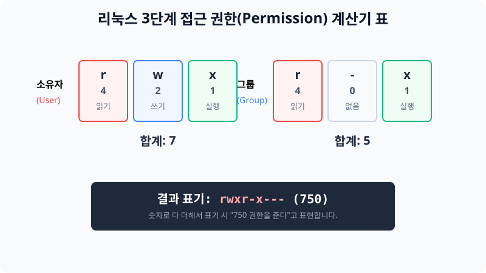
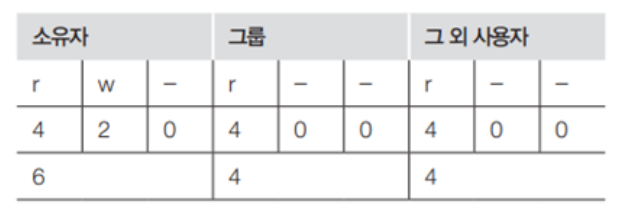
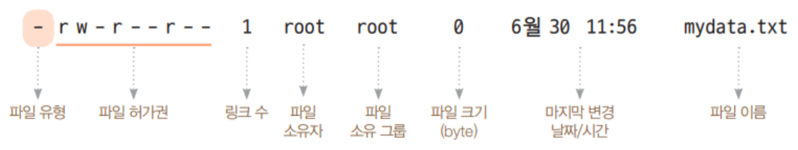
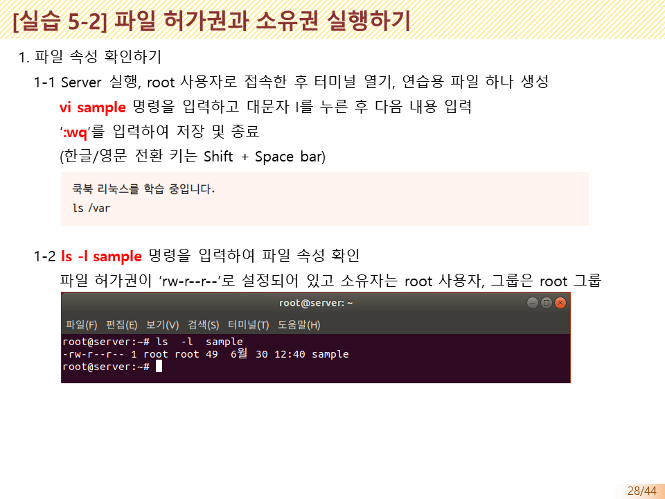
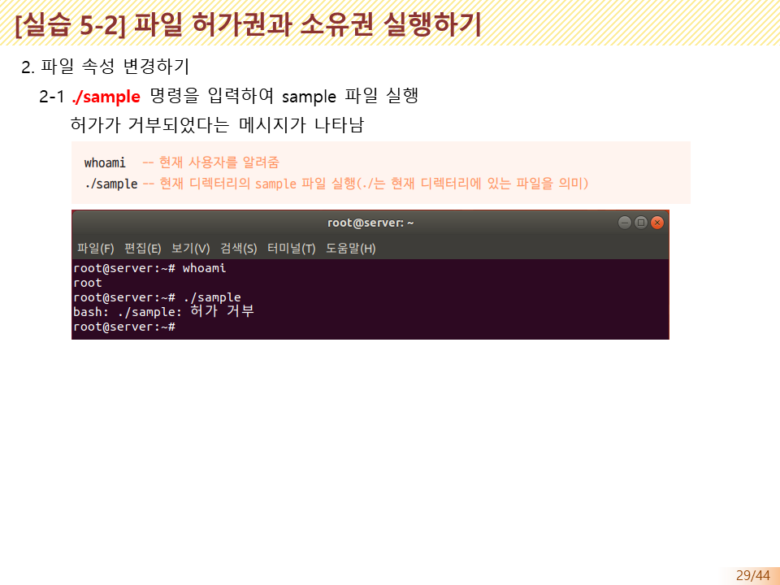
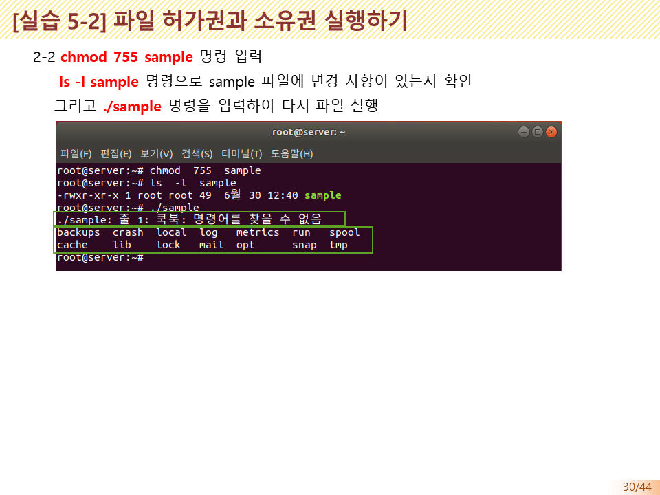
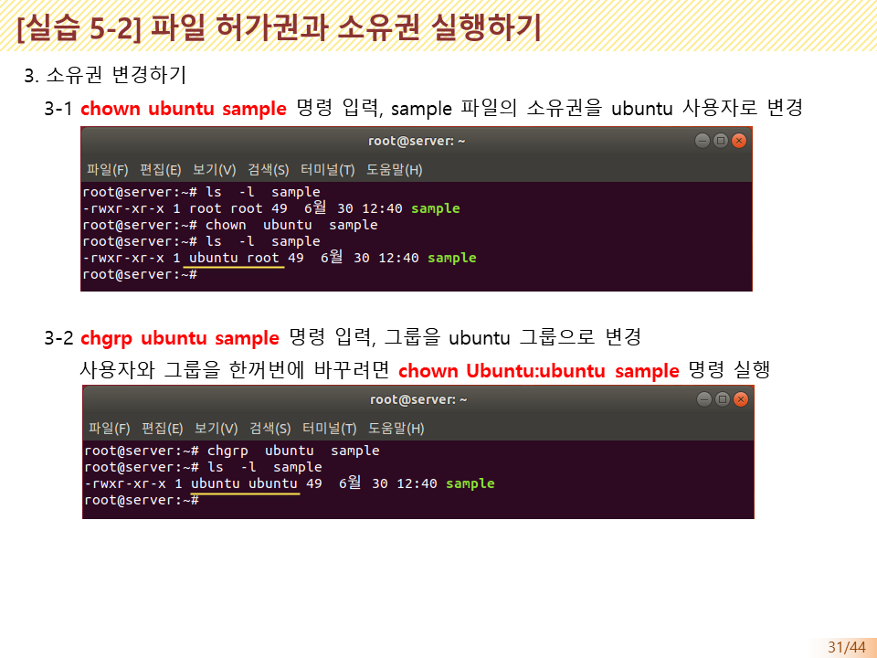

# 6.3 누가 접근할 수 있을까? 접근 허가권(Permission) 제어

사용자는 1대의 서버 시스템을 사용하면서, 개인의 정보가 담긴 중요한 보안 폴더는 타인이 열람하지 못하게 철통같이 막아두어야 합니다. 반대로 협업을 위한 작업 폴더는 모두가 읽고 쓸 수 있도록 시원하게 열어주어야 하죠. 


> **동작 원리**: 파일이나 디렉터리는 항상 `읽기(r, 4점)`, `쓰기(w, 2점)`, `실행(x, 1점)`이라는 3단계 점수가 소유자별 세트 구조로 부여됩니다. 이를 통해 누가 볼 수 있고 누가 편집할 수 있는지 통제합니다.

---

## 1. 허가권 (Permission) 모드 이해

리눅스 내 모든 파일들의 접근 제어 속성은 다음처럼 3열 횡대로 구성된 문자로 표현됩니다.

### 1.1 파일 허가권의 3요소 (알파벳 매핑)
- **`r` (Read / 읽기, 조회)**: 파일을 눈으로 볼 수권한 (숫자 표기: **4**)
- **`w` (Write / 쓰기, 지우기)**: 내용물을 수정하거나 파일을 삭제할 수 있는 무서운 권한 (숫자 표기: **2**)
- **`x` (eXecute / 실행, 넘어가기)**: 이 파일이 스크립트라면 더블클릭해서 실행할 권한. 디렉터리라면 그 폴더 안에 통과해서 들어갈 수 있는 권한 (숫자 표기: **1**)
- `-` (부족 / Nothing): 아무 권한도 없다는 의미 (숫자 표기: **0**)

> (기존 작성된 권한 숫자 변환 도해입니다.)
> 

만약 파일의 속성을 조회했을 때 `-rw-r--r--` 라고 나온다면, 이 난해한 세 묶음의 문자열은 다음을 의미합니다.
* 앞 3글자 `rw-` : 주인(소유자)은 읽고 쓸 수만 있다 (합계 4+2=6)
* 중간 3글자 `r--` : 부서 사람(그룹)은 읽을 수만 있다 (합계 4)
* 끝 3글자 `r--` : 지나가던 타인(Other)도 읽을 수만 있다 (합계 4)
=> 이것을 숫자 압축 암호로 **644 권한** 이라고 실무에서는 부릅니다.

> (실제 터미널 조회 결과 화면입니다.)
> 

---

## 2. chmod 명령어로 권한 변경하기

내가 소유자로 등록된 파일의 접근 권리를 다른 사람들에게 열어주거나 뺏어오고 싶다면 `chmod` (Change Mode) 명령어를 사용합니다.

### 2.1 절대 모드 (숫자 더하기 방식)
앞서 배운 숫자의 덧셈 조합으로 한 큐에 권한을 지정합니다.
- `chmod 777 mydata.txt` : 모든 사람(소유자, 그룹, 남)이 읽고 쓰고 실행할 수 있는 대혼돈의 완벽한 허혈 상태로 만듭니다. (777 방식은 회사에서 보안상 최악이므로 지양해야 합니다.)
- `chmod 750 mydata.txt` : 주인에게는 모든 권한(7)을 주고, 같은 부서에게는(5) 수정 빼고 읽/실행만 열어주며, 외부인(0)은 아예 못보게 차단합니다.

### 2.2 상대 모드 (기호로 더하고 빼주기)
숫자로 안 치고 직관적으로 기호 문자를 활용해 빼거나 줄 수 있습니다.
- `chmod u+x mydata.test` : (u)주인(User)에게 (x)실행권한을 더해달라(+)는 명령입니다.
- `chmod g-w mydata.test` : (g)그룹(Group) 멤버들에게서 (w)쓰기 권한을 빼앗아(-) 오라는 뜻입니다.

---

## 3. [실습] 내 파일의 권한을 마음대로 조작하기

### 실습 1. 권한 변경 (777 모드)
테스트 파일을 만들고, 모든 사람에게 권리를 풀어주는 작업을 해봅니다.
```bash
# 빈 파일을 만듭니다.
touch test_permit.txt

# 현재 부여된 기본 파일 권한(보통 rw-r--r--)을 가장 좌측 열에서 눈으로 확인합니다.
ls -l test_permit.txt

# 파일을 완전히 개방(777) 해버립니다.
chmod 777 test_permit.txt

# 다시 목록을 조회하면 전체 사용자에게 rwxrwxrwx 로 열린 것을 볼 수 있습니다.
ls -l test_permit.txt
```

### 추가 참조 슬라이드 자료 모음
*(기존 작성자님이 남겨두신 권한 설정 요약 슬라이드 자료입니다.)*
> 
> 
> 
> 
