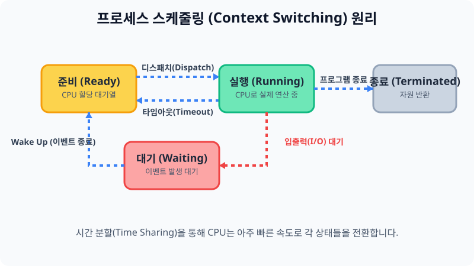
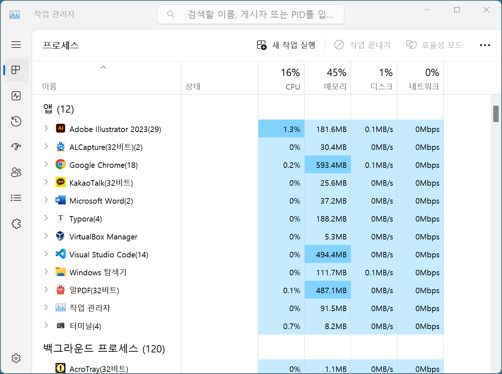
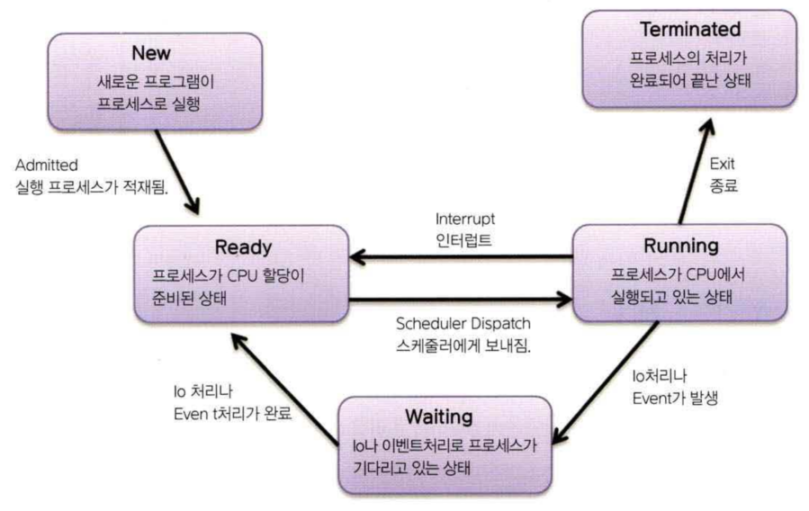

# 4.3 리눅스의 심장, 프로세스(Process)의 이해

리눅스 서버가 안정적으로 여러 사람의 요청을 동시에 처리하며 돌아가게 하려면, 내부적으로 구동 중인 수많은 프로그램, 즉 프로세스 시스템이 원활하게 상호작용해야 합니다.

> **동작 원리**: CPU는 눈에 보이지 않을 만큼 찰나의 시간 분할(Time Sharing)을 통해 하나의 프로세스를 `실행(Running)`했다가 강제로 `준비(Ready)` 상태로 내리는 스케줄링을 반복하여 마치 100개의 프로그램이 동시에 작동하는 것처럼 속입니다.

---

## 1. 프로세스란 무엇인가?

컴퓨팅 환경에서 설치된 '프로그램'이 하드디스크에 잠들어 있는 정적인 상태라면, 이를 더블클릭하여 메모리에 적재된 순간부터 그것을 활동적인 **프로세스(Process)** 라고 부릅니다. 
운영체제는 하나의 무거운 프로그램을 통째로 실행하지 않고, 여러 개의 작은 조각으로 분할하여 대기와 실행을 무한히 반복시키는 기법을 씁니다. 이런 규칙들을 통해 여러 프로세스들이 "동시에 실행되는 것처럼" 보이는 것입니다.

### 1.1 계층 구조와 PID 식별자
* **PID (Process ID)**: 리눅스에서는 구동되는 모든 프로세스에 주민등록번호와 같은 고유한 번호(`PID`)를 부여해 관리합니다.
* **부모와 자식**: 프로세스가 무언가 거대한 업무를 돕기 위해서 자신에게 종속되는 새로운 프로그램 가지를 호출할 때, 이 관계를 `부모 프로세스(Parent Process)`와 `자식 프로세스(Child Process)`라고 부릅니다. 자식은 부모가 종료되면 고아(Orphan) 상태가 될 위험이 있습니다.

> (윈도우에서도 다음과 같은 작업관리자 프로세스 관리 표를 확인할 수 있으며, 동일한 동작 개념입니다.)
> 

---

## 2. 디스패처와 프로세스 스케줄링

운영체제 뇌인 커널은 복수의 프로그램들이 동시에 매끄럽게 돌아가는 것처럼 보이게 만들기 위해, **'누구에게 몇 초 동안 CPU를 쓰게 해 줄지'** 일정한 규칙에 따라 분배 스케줄링을 지시합니다.

> (기존 작성된 프로세스 간 상태 주기 그림 자료입니다.)
> 

### 2.1 사이클 상태 변화
처리되는 모든 프로세스는 커널이 부여한 우선순위(Priority)에 따라 CPU를 빼앗겨 멈추거나 계속 할당받는 롤러코스터 사이클을 반복하게 됩니다.

1. **준비 대기열 (Ready Queue)**: CPU가 지금 바빠서 연산을 처리해 줄 수 없으므로 우선 대기표를 뽑고 기다리는 수백 개의 프로그램 통입니다.
2. **실행 (Running)**: 배정된 순번이 오면 아주 짧은 0.0001초 동안 CPU에 들어가 연산을 수행합니다 (디스패치/Dispatch). 할당된 시간이 끝나면 커널이 타임아웃을 걸어 강제로 다시 1번 상태(Ready)로 내쫓습니다.
3. **입출력 대기 대피소 (Waiting / Blocked)**: 만약 연산 도중 하드디스크에서 파일을 불러오거나 사용자의 마우스 클릭을 한참 기다려야 할 땐 굳이 비싼 CPU 안에 머물지 못하고 대기소로 방출되어 이벤트 발생을 대기합니다.
