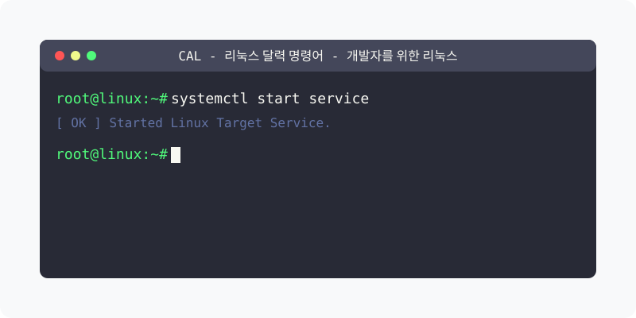

[⬅️ 이전](../) &nbsp;|&nbsp; [🏠 분류 목차](../../../)

# cal 명령어

`cal` 명령어는 리눅스 시스템에서 달력을 출력하는 유틸리티입니다. 이 명령어는 현재 월의 달력이나 지정된 년도, 월의 달력을 터미널에 표시할 수 있습니다.

## 1️⃣ 핵심 학습 가이드
세부 옵션과 예제를 분할하여 제공합니다.

* [기본 사용법](part_1/)

  해당 파트의 상세 내용을 학습합니다.

* [주요 옵션](part_2/)

  해당 파트의 상세 내용을 학습합니다.

* [한글 달력 설정](part_3/)

  해당 파트의 상세 내용을 학습합니다.

* [고급 사용법](part_4/)

  해당 파트의 상세 내용을 학습합니다.

* [문제 해결](part_5/)

  해당 파트의 상세 내용을 학습합니다.

* [활용 예제](part_6/)

  해당 파트의 상세 내용을 학습합니다.

---

[⬅️ 이전](../) &nbsp;|&nbsp; [🏠 분류 목차](../../../)
