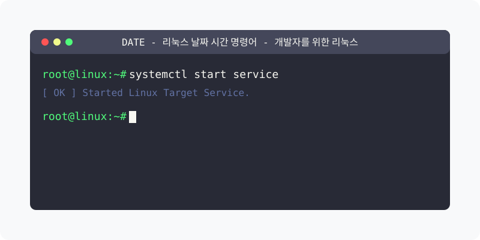

[⬅️ 이전](../) &nbsp;|&nbsp; [🏠 분류 목차](../../../)

# date 명령어

`date` 명령어는 리눅스 시스템에서 현재 날짜와 시간을 출력하거나 설정하는 유틸리티입니다. 이 명령어는 시스템의 현재 시간을 확인하고, 다양한 형식으로 날짜와 시간 정보를 표시할 수 있습니다.

## 1️⃣ 핵심 학습 가이드
세부 옵션과 예제를 분할하여 제공합니다.

* [기본 사용법](part_1/)

  해당 파트의 상세 내용을 학습합니다.

* [날짜 형식 지정](part_2/)

  해당 파트의 상세 내용을 학습합니다.

* [고급 사용법](part_3/)

  해당 파트의 상세 내용을 학습합니다.

* [실용적인 예제](part_4/)

  해당 파트의 상세 내용을 학습합니다.

* [문제 해결](part_5/)

  해당 파트의 상세 내용을 학습합니다.

* [고급 기능](part_6/)

  해당 파트의 상세 내용을 학습합니다.

---

[⬅️ 이전](../) &nbsp;|&nbsp; [🏠 분류 목차](../../../)
