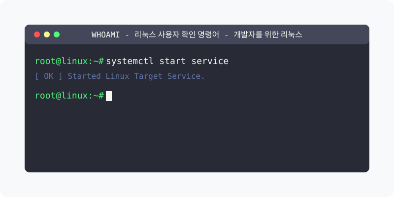

[⬅️ 이전](../) &nbsp;|&nbsp; [🏠 분류 목차](../../../)

# whoami 명령어

`whoami` 명령어는 리눅스 시스템에서 현재 로그인한 사용자의 사용자명을 출력하는 유틸리티입니다. 이 명령어는 시스템에 접속한 당시의 계정명과 접속 정보를 확인하는 데 매우 유용합니다.

## 1️⃣ 핵심 학습 가이드
세부 옵션과 예제를 분할하여 제공합니다.

* [기본 사용법](part_1/)

  해당 파트의 상세 내용을 학습합니다.

* [명령어 설명](part_2/)

  해당 파트의 상세 내용을 학습합니다.

* [주요 특징](part_3/)

  해당 파트의 상세 내용을 학습합니다.

* [관련 명령어와의 차이점](part_4/)

  해당 파트의 상세 내용을 학습합니다.

* [고급 사용법](part_5/)

  해당 파트의 상세 내용을 학습합니다.

* [실용적인 예제](part_6/)

  해당 파트의 상세 내용을 학습합니다.

* [문제 해결](part_7/)

  해당 파트의 상세 내용을 학습합니다.

* [고급 활용](part_8/)

  해당 파트의 상세 내용을 학습합니다.

---

[⬅️ 이전](../) &nbsp;|&nbsp; [🏠 분류 목차](../../../)
