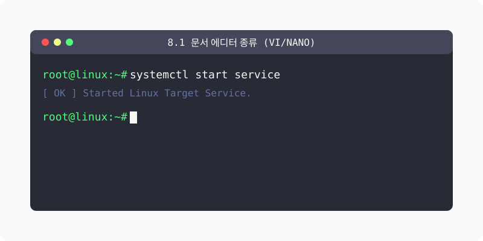
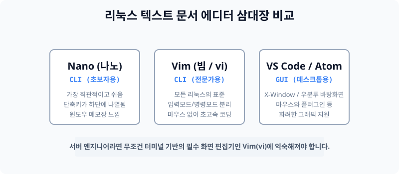

[⬅️ 이전: whoami - 리눅스 사용자 확인 명령어 - 개발자를 위한 리눅스](../../04_2_advanced/04_2_2_shell/whoami/) &nbsp;|&nbsp; [🏠 분류 목차](../../../) &nbsp;|&nbsp; [다음: 8.2 파이프(Pipe)와 필터 ➡️](../04_3_2_pipe/)



# 8.1 서버 운영의 핵심, 텍스트 기반 에디터 도구들

서버를 개발하거나 세팅하기 위해서는 텍스트 파일을 새로 만들고 코드를 수정하는 작업이 필수적입니다. 리눅스에서는 환경(터미널이냐 그래픽화면이냐)에 따라 전혀 다른 유형의 편집기를 사용합니다.


> **동작 원리**: 그래픽 환경을 그릴 수 있는 우분투 데스크톱 화면에서는 VS Code 같은 마우스 지원 편집기를 설치해 쓰면 되지만, 서버 컴퓨터(CLI)에서는 오직 글씨만 표기되므로 키보드만으로 마우스를 완벽히 대체하는 `vi(vim)`이나 `nano` 같은 전용 에디터에 의존해야 합니다.

---

## 1. 텍스트 기반 편집기 (서버 원격 제어용)
까만 터미널 화면(CLI)에서 원격 서버에 접속 중일 때 사용하는 에디터들입니다.

### 1.1 Vim (Vi IMproved)
- **리눅스 최고의 권위이자 표준 에디터**: 1970년대부터 유닉스에 탑재되었던 `vi`를 계승/발전시킨 버전으로, 오늘날의 모든 서버 배포판에 기본 내장되어 있습니다.
- 명령을 내리는 모드(Command Mode)와 글씨를 쓰는 모드(Insert Mode)가 극단적으로 분리되어 있어 처음에는 굉장히 난해하지만, 손에 익으면 세계에서 가장 빠르게 코드를 편집할 수 있는 강력한 무기가 됩니다.

### 1.2 Nano
- **가장 직관적인 초보자용 에디터**: 터미널 화면 맨 밑에 단축키 보드(예: `^O` = 저장, `^X` = 종료)가 항상 떠 있어서, 단축키를 외우지 않고도 윈도우 메모장 쓰듯이 편안하게 사용할 수 있는 도구입니다. 가벼운 설정 파일을 고칠 때 유용합니다.

---

## 2. GUI 데스크톱 환경에서의 편집기
일반 컴퓨터 모니터처럼 X-Window (아이콘, 마우스 화면) 창이 지원되는 우분투 デ스크톱에서 쓰는 에디터들입니다.

- **VS Code**: 마이크로소프트에서 만든 무료 최강의 개발 에디터. 플러그인이 방대합니다.
- **gedit**: 우분투 바탕화면에서 기본으로 제공하는 가장 심플하고 깔끔한 메모장입니다.
- **Sublime Text / Atom**: 개발자들이 자주 쓰는 화려하고 예쁜 테마 기반의 코드 에디터 라인업입니다.

---

## 3. [실습] Nano와 Vim 에디터 직접 열고 닫아보기

키 입력만으로 서버 파일을 제어하는 연습입니다.

### 실습 1. 쉬운 에디터, nano로 파일 쓰기
직관적인 나노 에디터로 파일을 하나 만들어 봅니다.
```bash
# nano 에디터 화면으로 test1.txt 파일을 만듭니다.
nano test1.txt

# 자유롭게 글씨를 타건합니다. "Hello Linux Nano!"
# Ctrl + O 를 누른 후 Enter를 쳐서 저장(Output)합니다.
# Ctrl + X 를 눌러 편집기 창을 빠져나옵니다.
```

### 실습 2. 표준 에디터, Vim(vi) 작동해보기
vi는 마우스나 화살표로 막 구동되지 않으므로 규칙을 따라야 합니다.
```bash
# vim(vi) 에디터로 test2.txt 파일을 엽니다.
vi test2.txt

# (1) 처음엔 명령 모드이므로 아무리 타자기를 쳐도 글씨가 잘 안 써집니다.
# (2) 키보드에서 i (Insert) 키를 누릅니다. (화면 밑에 -- INSERT -- 가 뜸)
# (3) 자유롭게 글씨를 씁니다. "Hello Linux Vim!"
# (4) 작성을 멈추고 명령을 내리기 위해 키보드 맨 왼쪽 위 ESC 키를 누릅니다.
# (5) :wq (콜론 누른 채로 w, q 입력) 를 치고 Enter를 누르면 저장 후 종료됩니다.
```

---

[⬅️ 이전: whoami - 리눅스 사용자 확인 명령어 - 개발자를 위한 리눅스](../../04_2_advanced/04_2_2_shell/whoami/) &nbsp;|&nbsp; [🏠 분류 목차](../../../) &nbsp;|&nbsp; [다음: 8.2 파이프(Pipe)와 필터 ➡️](../04_3_2_pipe/)
