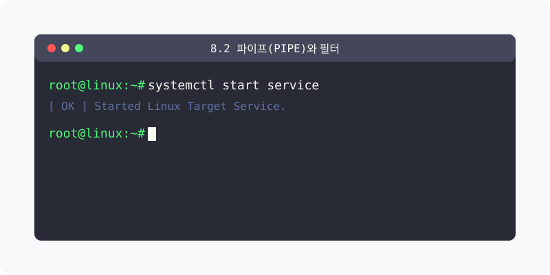

[⬅️ 이전: 8.1 문서 에디터 종류 (vi/nano)](../04_3_1_vim/) &nbsp;|&nbsp; [🏠 분류 목차](../../../) &nbsp;|&nbsp; [다음: 8.3 리다이렉션(Redirection) ➡️](../04_3_3_redirect/)



# 8.2 파이프(Pipe), 두 개 이상의 명령어를 조합하는 마법

리눅스의 수많은 명령어들은 혼자서 쓰일 때보다 다른 명령어 결과물을 마치 폭포수처럼 이어받아 걸러서 사용할 때 진정한 슈퍼 파워를 발휘합니다. 이를 가능하게 해 주는 것이 **파이프(Pipe)** 기능입니다.

<!-- Broken Image Removed: ./img/pipe_flow.svg -->
> **동작 원리**: 앞쪽에 쓴 명령어가 만들어 낸 출력 결과물 목록들을 화면에 당장 보여주는 대신, 마치 상수도 수도관 파이프로 흘려보내듯 뒷쪽 명령어의 '입력' 데이터 소스로 집어넣어 걸러냅니다.

---

## 1. 파이프 기호 ( | ) 의 이해

키보드에서 Shift 키와 `₩(원화)` 또는 역슬레시(`\`) 키를 누르면 나오는 알파벳 'l'이 아닌 일직선 기호(`|`)를 파이프라고 부릅니다. 이 기호를 사용하여 명령어들의 체인을 만들 수 있습니다.

### 1.1 기본 특징과 필터의 조합
파이프를 사용하면 화면에 수천 줄의 글씨가 출력되어 눈으로 찾기 불가능한 텍스트 뭉치들을, 화면에 띄우기 전에 한 번 더 중간 필터(Filter)에 가두어 데이터를 효과적으로 잘라 처리할 수 있습니다. 

> (기존 명령어 파이프 처리 도해 이미지입니다.)
> <!-- Broken Image Removed: ./img/image-20230416170515847.png -->

### 1.2 대표적인 파이프 동작 사례
```bash
ls -l | grep ".txt"
```
위 코드는 다음과 같이 연속 동작합니다.
1. `ls -l`: 현재 디렉터리의 그 수많은 100만 개의 파일 목록을 전부 출력해 봅니다.
2. `|`: 출력된 파일 리스트를 화면에 쏟아내지 말고 파이프관으로 부어 넣습니다.
3. `grep ".txt"`: 파이프를 통해 들어온 100만 줄의 데이터들을 검색해 오직 `.txt` 라는 글자가 포함된 줄거리만 필터링하여 찾아내서 화면에 보여줍니다.

---

## 2. [실습] 파이프 연동으로 긴 프로세스 찾기

서버에서 돌고 있는 수천 개의 백그라운드 구동 프로그램 목록 속에서 오직 내가 알고 싶은 단어만 족집게처럼 뽑아내는 파이프 필터 실습입니다.

### 실습 1. 무지성으로 프로세스 뽑아보기
```bash
# 본인 서버의 모든 사용자가 구동 중인 수천 줄의 프로세스 기록을 다 출력합니다.
# (눈이 부시고 위로 스크롤해서 찾기가 불가능합니다)
ps -ef
```

### 실습 2. 파이프(|) 로 필터링해서 찾기
```bash
# 전체 프로세스 리스트를 grep 검색 명령어 안으로 빨아들이게끔 '|' 를 씁니다.
# 단, 리눅스와 관련된 커널(kernel) 단어가 들어간 파트만 필터링하게 시킵니다.
ps -ef | grep "kernel"

# 이처럼 pipe는 명령어 3개, 4개까지 무한한 연결이 가능합니다.
# kernel 글씨 찾은 결과물을 또 받아서 wc -l(단어 갯수 세기)로 넘깁니다.
ps -ef | grep "kernel" | wc -l
```

---

[⬅️ 이전: 8.1 문서 에디터 종류 (vi/nano)](../04_3_1_vim/) &nbsp;|&nbsp; [🏠 분류 목차](../../../) &nbsp;|&nbsp; [다음: 8.3 리다이렉션(Redirection) ➡️](../04_3_3_redirect/)
