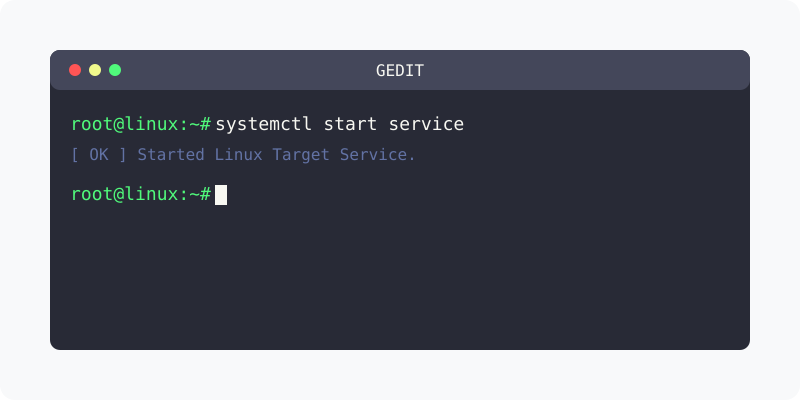

[⬅️ 이전: 8.1 문서 에디터 종류 (vi/nano)](../) &nbsp;|&nbsp; [🏠 분류 목차](../../../../) &nbsp;|&nbsp; [다음: nano ➡️](../nano/)

# gedit
그래픽 모드에서 부팅된 X윈도는 gedit라는 기본 GUI 에디터를 제공한다. redhat, CentOS나 우분투 등 여러 리눅스 OS에서 제공한다.
> https://www.leafcats.com/111

## 실행
터미널에서 gedit 명령어를 통해 실행할 수 있다.

---

[⬅️ 이전: 8.1 문서 에디터 종류 (vi/nano)](../) &nbsp;|&nbsp; [🏠 분류 목차](../../../../) &nbsp;|&nbsp; [다음: nano ➡️](../nano/)
