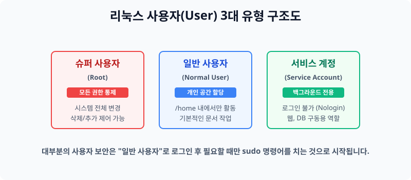

# 6.1 사용자와 관리자(Root) 권한의 이해

리눅스는 서버 1대에 여러 사용자가 동시에 접속하여 각자의 공간을 독립적으로 가지고 사용할 수 있도록 철저하게 설계된 다중 사용자(Multi-User) 시스템입니다.


> **동작 원리**: 서버의 주인을 일반 사용자와 슈퍼 관리자로 철저히 계급화하여, 일반 해커나 바이러스가 침투해도 가장 중요한 핵심 시스템이 망가지는 것을 원천 봉쇄합니다.

---

## 1. 운영체제 내 사용자의 종류

리눅스 시스템에서는 사용자의 종류에 따라 할 수 있는 활동 반경이 엄격히 제한됩니다. 이러한 구분을 통해 시스템 보안을 유지합니다.

### 1.1 일반 사용자 (Normal User)
시스템 운영에 직접적인 영향을 끼치지 못하는 일반적인 사용자들입니다.
- 오직 자신의 할당된 공간(`/home/...`) 내부의 파일들만 생성하거나 지울 수 있습니다.
- 환경 설정을 함부로 변경하거나 서버를 끄고 켤 수 있는 권한이 없습니다.

### 1.2 슈퍼 사용자 (Root / Superuser / Administrator)
시스템의 모든 리소스에 접근할 수 있는 단 하나의 무소불위 최고 권한 마스터 계정입니다.
- 운영체제에서 루트(Root)는 어떠한 폴더든 접근할 수 있고, 사용자를 삭제하거나 시스템을 아예 포맷해 버릴 수도 있는 특별한 권한입니다.
- 그러나 초보자가 함부로 로그인하여 잘못된 명령어를 치면 시스템이 복구 불능 상태로 파괴될 수 있기 때문에, 평소에는 일반 사용자로 접속하다가 꼭 특정 설정이 필요할 때만 잠시 이 권한을 빌려 사용하는 것이 일반적인 보안 원칙입니다.

### 1.3 서비스 구동 계정 (Service Account)
사람이 직접 타이핑을 치고 로그인하기 위해 쓰이는 계정이 아닙니다.
- 서버 안에서 돌아가고 있는 아파치(Apache 웹 서버), 마리아DB(데이터베이스) 같은 프로그램들이 백그라운드에서 조용히 자신의 폴더만 열람하며 작업을 하기 위해 부여받는 가상의 유령 계정들입니다. (예: `www-data`, `mysql` 등)

---

## 2. 관리자 권한 차용 (sudo 제어)

보안을 위해 평상시에는 `Root`로 직접 접속하는 것을 막아 두지만, 일반 사용자가 가끔 시스템 포트를 열거나 프로그램을 설치하려면 잠시 이 권한을 빌려올 방법이 있어야 합니다.

이럴 때 사용하는 명령어가 바로 **`sudo` (SuperUser DO)** 입니다.
어떠한 명령어 앞에 `sudo`라는 단어만 붙이고 실행하면(예: `sudo apt update`), 그 명령어 단 한 줄에 대해서만 1회성으로 루트의 강력함이 발현됩니다. 이때 시스템은 정말 본인이 맞는지 증명하라며 사용자의 현재 비밀번호를 다시 한 번 물어보게 됩니다.

---

## 3. [실습] sudo 권한 테스트해보기

리눅스 터미널 환경에서 내가 일반 사용자인지 Root 사용자인지 파악하고 권한을 빌려보는 실습입니다.

### 실습 1. 나의 권한 식별하기
터미널을 열고 프롬프트 모양을 눈으로 확인하세요.
* `$` 모양 표기: 일반 사용자 모드 대기 상태.
* `#` 모양 표기: 강력한 Root 관리자 모드 상태 접속 중.

```bash
# 내 기본 아이디를 찍어봅니다.
whoami
```

### 실습 2. sudo 로 관리자 권한 빌려보기
일반 사용자가 함부로 들어갈 수 없는 `/root` 디렉터리에 억지로 진입해 봅니다.
```bash
# 권한이 없으므로 'Permission denied' 에러가 나면서 튕깁니다.
ls -l /root

# 그러나 명령어 앞에 sudo를 붙이면 비밀번호 확인 후 내부를 볼 수 있습니다.
sudo ls -l /root
```
