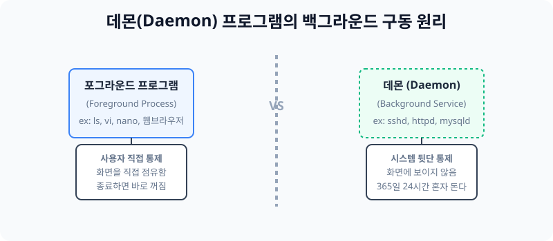

# 10.1 보이지 않는 유령 관리자, 데몬(Daemon)

서버(Server)는 클라이언트의 요청이 언제 들어올지 모르기 때문에 365일 24시간 항상 잠들지 않고 깨어 있어야만 합니다. 이렇게 화면에 보이지 않는 서버의 어두운 뒷단에서, 사용자의 지시 없이도 스스로 무한히 일하는 프로그램을 리눅스에서는 **데몬(Daemon)** 이라고 부릅니다. 


> **동작 원리**: 사용자가 키보드로 타건하여 화면을 직접 장악하는 프로세스는 `Foreground` 라고 합니다. (예: `vi` 에디터). 반대로, 화면 뒤로 완전히 숨어버려 유령(Daemon)처럼 시스템이 켜질 때부터 꺼질 때까지 네트워크 신호를 기다리며 죽지 않고 돌아가는 서버 프로그램들을 총칭하여 `데몬 프로세스`라고 부릅니다.

---

## 1. 리눅스 핵심 네트워크 서비스와 데몬
리눅스 서버 시스템에서 필수적으로 상주하는 3대장 핵심 데몬들은 보통 뒤에 유령이라는 뜻의 `d` 글자를 붙여서 통칭합니다.

### 1.1 Apache / Nginx (웹 데몬)
* **데몬명**: `httpd`, `nginx`
* **설명**: 크롬 브라우저를 통해 사람들이 웹사이트를 방문할 때마다 아름다운 홈페이지 화면 구성을 뿌려주는 서비스를 제공합니다. 하루 24시간 동안 사용자들의 클릭 요청을 응답합니다.

### 1.2 OpenSSH (보안 원격 데몬)
* **데몬명**: `sshd`
* **설명**: 전 세계 어느 노트북에서라도, 22번 포트를 뚫고 들어오는 주인(root 관리자)의 암호화된 접속 요청을 24시간 대기하며 기다려 주는 가장 핵심적인 숨은 문지기입니다. 이 데몬이 죽으면 원격 접속이 모조리 끊깁니다.

### 1.3 MySQL / MariaDB (DB 데몬)
* **데몬명**: `mysqld`
* **설명**: 데이터나 회원들의 비밀번호를 무한히 저장하고 검색할 수 있도록 대기하는 관계형 데이터베이스 저장소 데몬입니다.

---

## 2. [실습] 내 서버 안의 데몬(유령) 찾아내기

현재 우분투 서버에서 잠들지 않고 몰래 뒤에서 구동 중인 데몬(서비스) 프로세스들이 몇 개나 살아 있는지 터미널에서 스캔하는 실습입니다.

### 실습 1. 백그라운드(Background) 프로세스 색출
명령어 `ps -ef` 를 통해 뒷단에 떠 있는 모든 프로그램을 볼 수 있습니다. 이 중에서 유령을 의미하는 `d` 로 끝나는 엔진들을 검색기로 뽑아냅니다.
```bash
# 내 컴퓨터에서 구동 중인 수많은 백그라운드 엔진 로그 중 
# systemd 혹은 sshd 같은 데몬만 찾아서 구경합니다.
ps -ef | grep "sshd"
```
