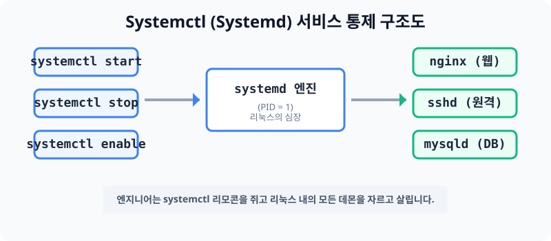

# 10.2 리눅스의 조물주 엔진, Systemd (systemctl) 

과거의 리눅스들은 컴퓨터를 부팅할 때 `init` 이라는 낡은 시스템을 사용해서 데몬(서비스)들을 순차적으로 거북이처럼 하나씩 느리게 켰습니다. 
하지만 최신 리눅스(Ubuntu 16 이상, CentOS 7 이상) 배포판들은 이것을 싹 갈아엎고, 리눅스의 심장이라 불리는 혁신적인 거대 진단 엔진인 **`systemd (시스템디)`** 를 표준으로 도입했습니다.


> **동작 원리**: 우분투가 부팅되자마자 PID 1번을 부여받고 최초로 일어나는 마더(Mother) 엔진이 바로 `systemd` 입니다. 엔지니어가 `systemctl (시스템컨트롤)` 이라는 명령줄 리모콘의 버튼을 누르면, 이 엔진이 지시를 받아 하위의 데몬(웹서버, 원격서버 등)들의 멱살을 잡고 통제하게 됩니다.

---

## 1. 낡은 원격 리모콘의 세대 교체 (service ➡️ systemctl)

과거 리눅스 책을 보면 서비스를 끄고 켤 때 `service nginx start` 처럼 가르칩니다. 하지만 현재 클라우드 환경에서는 모두 **`systemctl`** 문법으로 진화했습니다.

| 통제 목적 | 구버전 (낡음) | 신버전 (현재 권장/표준) |
|---|---|---|
| 서비스 구동 | `service sshd start` | `systemctl start sshd` |
| 서비스 중지 | `service sshd stop` | `systemctl stop sshd` |
| 서비스 재시작 | `service sshd restart` | `systemctl restart sshd` |
| 영구 자동 구동 (부팅마다) | `chkconfig sshd on` | `systemctl enable sshd` |
| 구동 로그 및 디버깅 확인 | 불가 (로그 파일을 직접 까서 봐야함) | `systemctl status sshd` |

위 표에서 보듯, `systemctl`은 단순히 껐다 켜는 것을 넘어 아주 폭넓은 통제력과 에러(Log) 진단 능력을 한 번에 제공합니다. 

---

## 2. Windows WSL 환경에서 systemd의 한계 (주의)
만약 당신이 물리버전 리눅스 깡통이나 VMware 가상머신이 아니라, 윈도우 안에 이식된 초경량 서브 쉘인 **WSL(Windows Subsystem for Linux)** 을 쓰고 있다면 아래와 같은 에러가 납니다.

```bash
# WSL 배시창에서 쳤을 때
hojin@hojin3:~$ systemctl
System has not been booted with systemd as init system (PID 1). Can't operate.
```
**이유**: WSL은 윈도우가 메인 호스트이기 때문에, 리눅스 고유의 심장 엔진인 `systemd`를 기본적으로 부팅시키지 않아서 발생하는 에러입니다. WSL2 환경의 유저라면 깃허브 스크립트 도구를 받아 강제로 활성화 시킬수는 있지만 제한적입니다. 가급적 네이티브 VMware나 AWS 클라우드 등을 실습에 이용하시길 권장합니다.

---

## 3. [실습] systemctl 리모콘 버튼 눌러보기

우분투 서버에서 `systemctl`을 활용하여 핵심 원격 서비스인 보안 쉘(ssh)을 다뤄보는 필수 실습입니다.

### 실습 1. 서비스 상태 디버깅 진찰하기
서비스가 에러가 나서 뻗었는지, 아주 싱싱하게 켜져 있는지 확인합니다. 제일 많이 쓰는 명령어입니다.
```bash
# 녹색 불씨(active)가 들어와 있는지 점검합니다.
sudo systemctl status sshd

# 다 보았다면 키보드에서 `q` 키를 눌러 빠져나옵니다!
```

### 실습 2. 서비스 강제 중단 및 재시작 
```bash
# (주의) 만약 지금 외부 원격 클라우드 작업중이시라면 이거 따라 치시면 끊깁니다. 자기 본체에서만 치세요.
sudo systemctl stop sshd

# 다시 강제로 살려냅니다.
sudo systemctl start sshd
# 또는
sudo systemctl restart sshd
```
